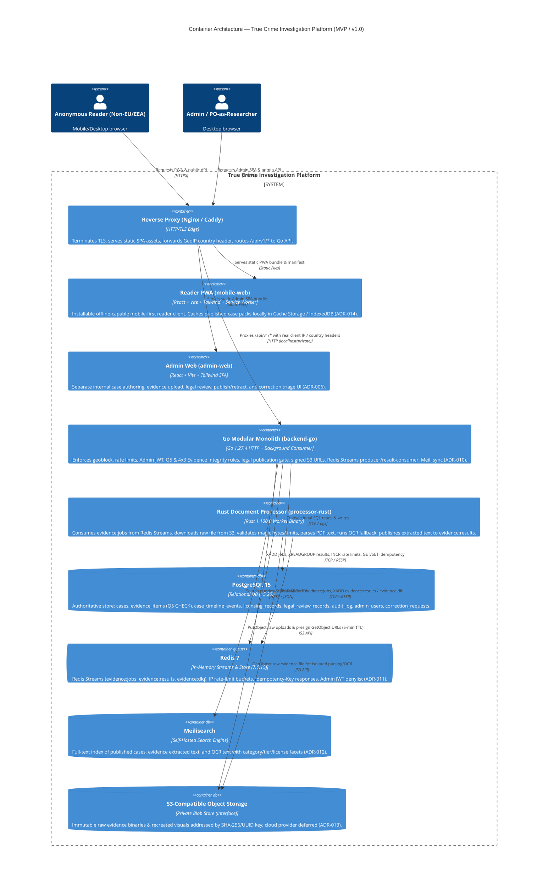

# High-Level Design (C4 Level 2)

- **Document Path:** `docs/05-architecture/HIGH_LEVEL_DESIGN.md`
- **Phase:** Phase 06 — Architecture (Charter PART 05)
- **Traceability:** `SYSTEM_CONTEXT.md`, `DATABASE_DESIGN.md`, `openapi.yaml`, `ADR-003`, `ADR-006`–`ADR-015`
- **Status:** Draft for PO Audit

---

## 1. C4 Level 2 — Container Diagram

---

## 2. Component Responsibilities Table

| Container | Technology | Primary Responsibilities | Explicit Failure Mode |
|---|---|---|---|
| **Reverse Proxy** | Nginx / Caddy (prod/staging); Vite dev proxy (local) | TLS termination, static serving of `mobile-web` and `admin-web`, forwarding trusted client IP / GeoIP header (`CF-IPCountry` or GeoIP module), request body size ceiling (`<= 25 MB` upload). | Proxy down -> total ingress outage (monitored via healthcheck); proxy misconfigured to trust client `X-Forwarded-For` -> mitigated by stripping untrusted headers at proxy edge (`SECURITY_ARCHITECTURE.md` T8). |
| **Reader PWA (`mobile-web`)** | React + Vite + Tailwind + Service Worker | Public catalog, Official Briefing + mandatory Genuine Gaps, Evidence Viewer (PDF/image/transcript), Verification Tier × License Status badges/banners, Timeline, Search UI, Correction Request form, Offline Case Pack cache (`REQ-006`/`007`). | API unreachable -> previously saved offline case packs remain readable from IndexedDB/Cache Storage; uncached routes show explicit offline fallback state. |
| **Admin Web (`admin-web`)** | React + Vite + Tailwind SPA (`ADR-006`) | Admin login, draft case CRUD, evidence multipart upload + tier/license/source_type metadata tagging, timeline authoring, legal-review sign-off recording, publish/retract triggers, correction request triage. | Admin SPA unavailable -> zero impact on public Reader PWA; founder can still invoke emergency kill-switch (`POST /api/v1/admin/cases/{id}/retract`) via `curl` against `backend-go`. |
| **Go API (`backend-go`)** | Go 1.27.4 modular monolith (`ADR-010`) | All business logic: EU/EEA geoblock middleware (`ADR-015`), rate limiting, idempotency, Admin JWT auth, Q5 & 4×3 matrix validation, legal publication gate, audit logging, Redis Streams job orchestration, Meilisearch indexing/deletion, S3 pre-signed URL generation. | Go API crash -> systemd/supervisor restarts process within seconds; in-flight uploads remain idempotent via `Idempotency-Key`; PostgreSQL transactions roll back cleanly. |
| **Rust Processor (`processor-rust`)** | Rust 1.100.0 standalone worker | Consumes `evidence:jobs`, streams blob from S3, verifies SHA-256 & file magic bytes, parses PDF text, executes OCR fallback for scanned PDFs/images, emits structured text/page count/status to `evidence:results` (or `evidence:dlq` after 3 failed attempts). | Worker crash/OOM on hostile PDF -> isolated from Go API; Redis Streams pending entry reclaimed via `XAUTOCLAIM` after visibility timeout, retried up to 3×, then moved to `evidence:dlq` and marked `PROCESSING_FAILED`. |
| **PostgreSQL 15** | PostgreSQL 15.20 | Single durable source of truth for all relational records, Q5 `CHECK` constraint, publication legal-review gate, and append-only `audit_log`. | Postgres down -> Go API returns `HTTP 503` on all reads/writes (healthcheck fails); zero silent writes; offline PWA packs continue serving cached reads on user devices. |
| **Redis 7** | Redis 7.0.15 | Durable-enough operational queue via Redis Streams (`AOF` enabled in staging/prod), fixed/sliding window rate limiting, `Idempotency-Key` response cache (24h TTL), Admin JWT revocation denylist. | Redis down -> evidence upload enqueue fails closed (`HTTP 503`); admin auth fails closed (`HTTP 503` if denylist unreachable); public read endpoints (`GET /cases`, `/evidence`) degrade gracefully by bypassing Redis and serving directly from Postgres (with local in-memory emergency rate limit fallback). |
| **Meilisearch** | Self-hosted Meilisearch (`ADR-012`) | Fast, typo-tolerant full-text search across published case summaries, timeline text, extracted PDF text, and OCR text, with `category`, `verification_tier`, and `license_status` facets. | Meilisearch unreachable -> `GET /api/v1/search` returns `HTTP 503` (`SEARCH_UNAVAILABLE`); case catalog, dossiers, timelines, and evidence viewing remain 100% operational via Postgres. Full index is deterministically rebuildable from Postgres. |
| **S3-Compatible Storage** | S3 Interface (`ADR-013`, provider deferred) | Private bucket holding raw uploaded PDFs, images, and recreated visuals keyed by immutable content-addressed path (`cases/{case_id}/evidence/{evidence_id}/{sha256}.{ext}`). | Storage unreachable -> evidence upload fails before DB commit (`HTTP 503`); `GET /api/v1/evidence/{id}` returns metadata with `file_url: null` or `HTTP 503` without corrupting DB state. |

---

## 3. Primary User Journeys & Data Flows

### Journey 1: Anonymous Reader Browses a Case → Views Evidence → Reads Timeline → Uses Search
1. **Ingress & Geoblock:** Reader opens `mobile-web` PWA; Reverse Proxy forwards request to `backend-go`. Geoblock middleware checks resolved country code against the 30-country EU/EEA blocklist (`ADR-008`). EU/EEA IPs immediately receive `HTTP 451` static page; permitted regions proceed.
2. **Catalog Browse:** PWA calls `GET /api/v1/cases?category=financial_crime`. Go queries PostgreSQL with an unconditional `WHERE status = 'PUBLISHED'` filter and returns cursor-paginated summaries (`{ data, next_cursor, has_more }`).
3. **Case Dossier & Timeline:** Reader selects a case; PWA calls `GET /api/v1/cases/{slug}`. Go fetches the published case, mandatory `genuine_gaps`, ordered `case_timeline_events` (including any `conflicting_sources`), and `evidence_items` metadata (never returning `DRAFT`/`IN_REVIEW`/`RETRACTED` rows — those return `HTTP 404`).
4. **Evidence Inspection:** Reader clicks a timeline evidence chip; PWA calls `GET /api/v1/evidence/{id}`. Go verifies the parent case is `PUBLISHED` and the item is not redacted, computes display-matrix badges/warnings, mints a 5-minute pre-signed S3 `GetObject` URL, and returns metadata + signed URL. PWA renders the PDF/image/transcript alongside `source_citation`, `sha256_hash`, and tier/license banners.
5. **Search:** Reader searches a shell-company name; PWA calls `GET /api/v1/search?q=...`. Go sanitizes the query string, applies mandatory filter `case_status = "PUBLISHED"` against Meilisearch, and returns ranked highlighted snippets linking back to `case_slug` and `evidence_id`.

### Journey 2: Admin Authors Case → Adds Evidence → Runs Legal Checklist → Publishes
1. **Authentication:** Admin signs into `admin-web` via `POST /api/v1/admin/login`. Go verifies Argon2id password hash against `admin_users`, enforces login rate limit (5 attempts / 15 min), and returns a short-lived signed JWT (60-min TTL).
2. **Draft Creation:** Admin creates a draft case (`POST /api/v1/admin/cases`, `status = 'DRAFT'`) with title, slug, category, jurisdiction, `eu_origin` flag, summary, and mandatory `genuine_gaps` entries. Draft is completely invisible to public routes (`HTTP 404`).
3. **Evidence Ingestion & Timeline:** Admin uploads primary PDFs/images (`POST /api/v1/admin/cases/{id}/evidence`) with `source_type`, `verification_tier`, `license_status`, `source_citation`, and `licensing_record_id` / `recreation_source_ids`. Go enforces the 4×3 matrix and Q5 rule before persisting, streams the file to S3, writes the `evidence_items` row (DB enforces Q5 `CHECK` constraint), and enqueues extraction on Redis Streams. Admin authors chronological `case_timeline_events` and updates case metadata (`PUT /api/v1/admin/cases/{id}`).
4. **Legal Sign-Off Gate:** After external US media/First Amendment counsel reviews the dossier offline, Admin records the sign-off via `POST /api/v1/admin/cases/{id}/legal-review`, inserting an immutable `legal_review_records` row (`reviewer_id`, `external_counsel_ref`, `reviewed_at`, `decision = 'APPROVED'`, prohibited-content checklist cleared).
5. **Publication (First Public Visibility):** Admin invokes `POST /api/v1/admin/cases/{id}/publish` (with `Idempotency-Key`). Inside a single PostgreSQL transaction, Go verifies: (a) valid `APPROVED` `legal_review_records` row exists, (b) `>= 1` Genuine Gaps entry, (c) zero `BLOCKED` evidence items, (d) `eu_origin = false` OR `gdpr_verified = true`, (e) all evidence items have `prohibited_content_cleared = true` and `processing_status = 'COMPLETED'`. Go transitions `cases.status` to `'PUBLISHED'`, sets `published_legal_review_id` and `published_at`, appends to `audit_log`, commits, and pushes the case + evidence documents to Meilisearch. **This transaction commit is the exact first moment readers can see the case.**

### Journey 3: Evidence Upload → Rust Processor Extracts Text/OCR → Indexed in Meilisearch → Reader Search Finds It
1. **Upload & Enqueue:** Admin posts multipart PDF/image to `POST /api/v1/admin/cases/{id}/evidence`. Go validates size (`<= 25 MB`), computes SHA-256 while streaming to S3, inserts `evidence_items` (`processing_status = 'PENDING'`), and executes `XADD evidence:jobs * ...` in Redis Streams with a unique `job_id`.
2. **Rust Extraction:** `processor-rust` consumes the message via `XREADGROUP GROUP rust-processors`, downloads the blob from S3, verifies its SHA-256 matches the payload, parses embedded PDF text (`parser`), runs OCR fallback if the PDF is scanned or an image (`ocr`), normalizes output (`extractor`), publishes `{ job_id, evidence_id, status: "COMPLETED", extracted_text, page_count, ocr_used }` to `evidence:results`, and calls `XACK` on `evidence:jobs`.
3. **Go Result Commit & Conditional Indexing:** Go's background result-consumer reads `evidence:results`, idempotently updates `evidence_items.extracted_text` and `processing_status = 'COMPLETED'` in PostgreSQL, and checks parent `cases.status`:
   - If the case is still `DRAFT`/`IN_REVIEW`, Go does **NOT** index the document in Meilisearch (preventing draft leaks). Indexing occurs only upon `POST /api/v1/admin/cases/{id}/publish`.
   - If a published case's evidence is re-indexed after an approved update/re-publish, Go upserts the document into Meilisearch with `case_status: "PUBLISHED"`.
4. **Reader Discovery:** Once published and indexed, `GET /api/v1/search?q=<extracted_term>` matches the OCR'd/extracted text in Meilisearch and returns the exact `evidence_id`, `case_slug`, and highlighted snippet.

---

## 4. What Is Explicitly NOT in the System (MVP / v1.0)

| Excluded Component | Governing Decision | Reason for Exclusion |
|---|---|---|
| **Consumer Auth / User Account Service** | `ADR-007` | v1.0 is anonymous-reading-only to eliminate India DPDP consumer-account obligations until DPDP counsel is funded in v1.1. |
| **Billing / Subscription Service (Domain 21)** | `PO_SCOPING_DECISIONS.md` #2 | Free for MVP & v1.0; evaluated only after 1,000 MAU and >= 3 case drops. |
| **Email / Transactional Notification Service** | Phase 06 Context / `SD-5` | Avoids SMTP/provider ops, DKIM/SPF setup, and paid quotas at MVP; correction requests persist in PostgreSQL and display in Admin Web. |
| **Community Theories & Moderation Service** | `ADR-009` | Zero continuous moderation staff; schema designed for v1.1, but zero UI/endpoints/workers built at launch. |
| **External CDN at MVP** | Phase 06 Scope / `$300–$500` Infra Budget | Reverse proxy serves compressed static Vite SPA bundles with aggressive cache headers (`Cache-Control: immutable` on hashed assets); CDN can be placed in front later with zero code change. |
| **Microservices / Service Mesh / Kafka** | `ADR-010`, `ADR-011` | Over-engineered for a solo founder; Go modular monolith + single Rust document worker + Redis Streams delivers full isolation at minimal operational cost. |

---

## 5. Deployment Topology

### (a) Local Sandbox (`ADR-003`, `ADR-005`)
- **Zero Docker:** All processes run directly on `127.0.0.1` inside the Debian 12 gVisor sandbox.
- **Managed by `Makefile`:** PostgreSQL 15 (`127.0.0.1:5432`, trust auth local-only) and Redis 7 (`127.0.0.1:6379`) run as `appuser` using `./data/`.
- **App Processes:** `backend-go` (`127.0.0.1:8080`), `processor-rust` (worker polling local Redis), Meilisearch binary (`127.0.0.1:7700`), local filesystem S3-interface stub (`./data/objects/`), and Vite dev servers for `mobile-web` (`:3000`) and `admin-web` (`:3001`).
- **CI Parity:** GitHub Actions runs PostgreSQL 15, Redis 7, and Meilisearch via **Docker service containers** alongside Go/Rust/Node test runners.

### (b) Staging (Future — Cloud Provider Deferred per `ADR-013`)
- **Topology:** Single small Linux VPS (2 vCPU / 4 GB RAM) running Reverse Proxy (TLS via Let's Encrypt), `backend-go`, `processor-rust` (1 worker), PostgreSQL 15 (`scram-sha-256` + localhost binding), Redis 7 (`requirepass` + AOF), and Meilisearch (master key enabled), backed by a staging bucket on the chosen S3-compatible provider.
- **Access:** Protected behind basic auth or IP allowlist so search engines and public visitors never index staging dossiers.
- **Verification Role:** Full rehearsal of DB migrations, EU/EEA geoblock rules, kill-switch latency (`<= 60s`), and Case 1 legal review before production cutover.

### (c) Production (Future — Within `$300–$500` 6-Month Infra Ceiling; Cloud Provider Deferred)
- **Topology:** Single hardened VPS (2–4 vCPU / 4–8 GB RAM) + private S3-compatible object storage bucket + automated encrypted off-box PostgreSQL backups (`pg_dump` to separate backup bucket daily).
- **Network Isolation:** Only Reverse Proxy ports `80/443` exposed publicly; PostgreSQL (`5432`, `scram-sha-256`), Redis (`6379`, auth + AOF), Meilisearch (`7700`, API key), and Go API (`8080`) bound exclusively to loopback/private interface.
- **Admin Surface Isolation:** `admin-web` served on a separate subdomain (e.g., `admin.<domain>`) with strict CSP, no indexing (`X-Robots-Tag: noindex`), and optional IP allowlist.
- **Failure Recovery:** Process supervision (`systemd` with automatic restart on failure); if Meilisearch data corrupts, Go runs a CLI/admin reindex command rebuilding the index cleanly from PostgreSQL; if VPS fails, restore from latest encrypted daily `pg_dump` + immutable S3 evidence bucket.
