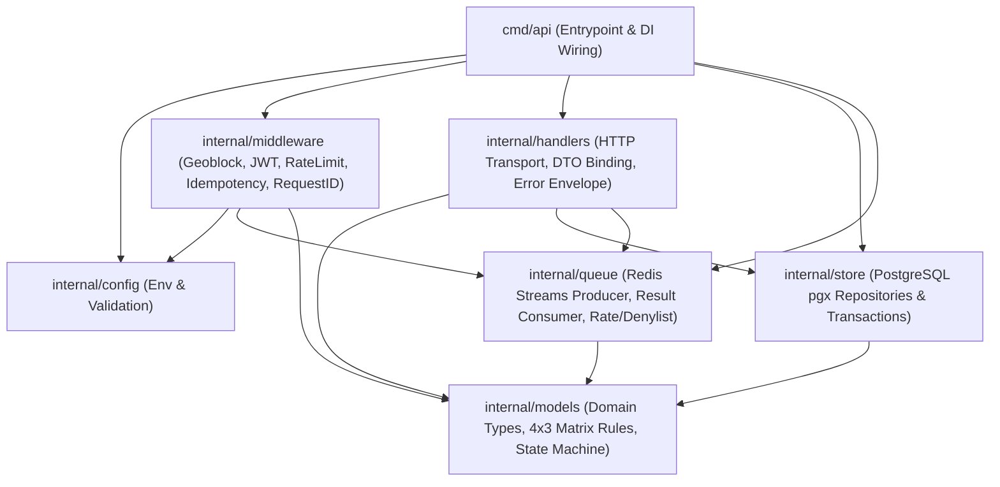
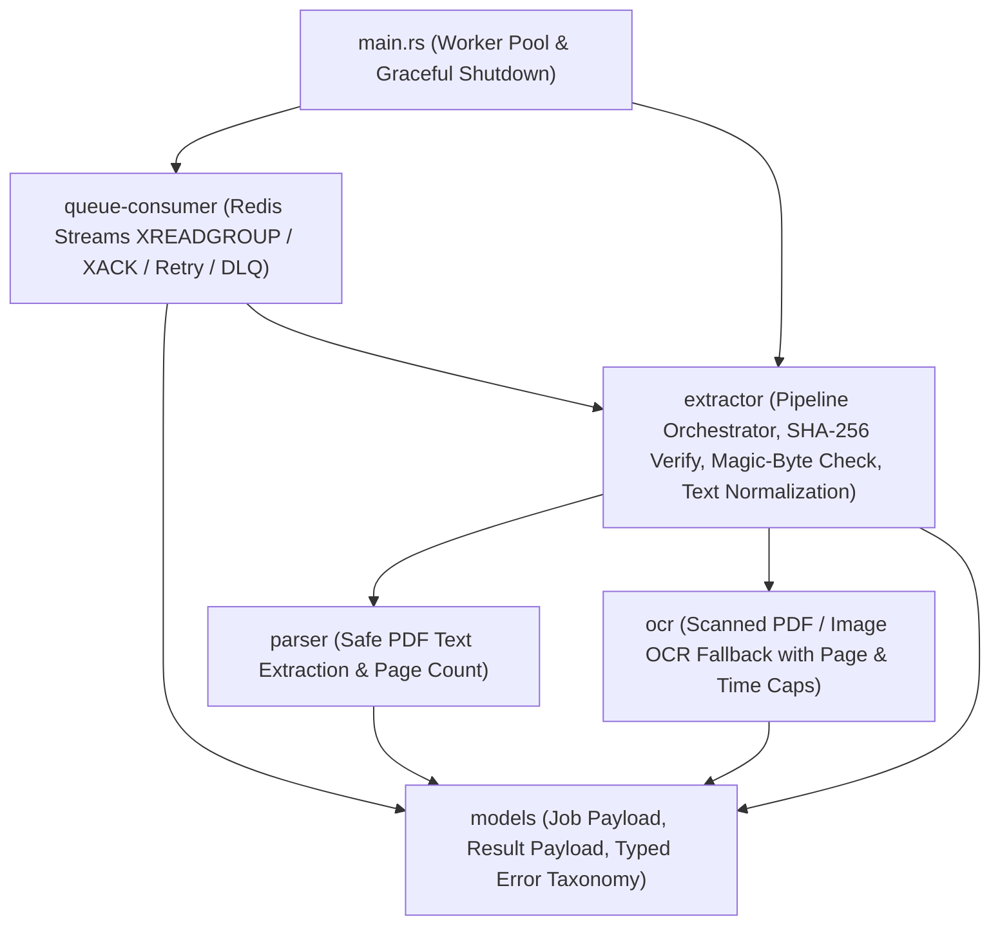

# Low-Level Design (LLD)

- **Document Path:** `docs/05-architecture/LOW_LEVEL_DESIGN.md`
- **Phase:** Phase 06 — Architecture (Charter PART 05)
- **Traceability:** `HIGH_LEVEL_DESIGN.md`, `DATABASE_DESIGN.md`, `openapi.yaml`, `SECURITY_ARCHITECTURE.md`, `ADR-010`–`ADR-015`
- **Status:** Draft for PO Audit *(Design specification only — no code or scaffolding created in Phase 06)*

---

## 1. Go API Package Structure (`backend-go`)

`backend-go` is structured as a clean **modular monolith** (`ADR-010`) with strict unidirectional dependencies so domain rules (Evidence Integrity matrix, legal publication gate, Q5 third-party exhibit rule) can be unit-tested without HTTP or database fixtures.



### Package Responsibilities & Dependency Rules

| Package | Responsibility | Allowed Dependencies | Must NEVER Depend On |
|---|---|---|---|
| `cmd/api` *(and `cmd/reindex`)* | Process entrypoint, signal handling (graceful shutdown), dependency wiring, starting HTTP server + background Redis Streams result consumer goroutine. | All `internal/*` packages | — |
| `internal/config` | Parses and validates environment variables at startup; fails fast if required secrets (`JWT_SECRET`, `DATABASE_URL`, `MEILI_API_KEY`, `S3_*`, `GEOIP_DB_PATH`) are missing or insecure in non-local mode (`ADR-005`). | Go stdlib only | Any other `internal/*` package |
| `internal/models` | Pure domain structs, enums (`CaseStatus`, `VerificationTier`, `LicenseStatus`, `SourceType`), 4×3 Display Rules Matrix evaluator, Q5 validator, publication precondition checker, cursor pagination & error envelope types. | Go stdlib only | `handlers`, `store`, `queue`, `middleware`, `config` |
| `internal/middleware` | Request ID injection, structured JSON access logging (zero PII), EU/EEA IP geoblock (`ADR-008`, `ADR-015`), Redis-backed rate limiting, `Idempotency-Key` middleware, Admin JWT validation + revocation denylist check, panic recovery, strict security headers. | `config`, `models`, `queue` | `handlers`, `store` |
| `internal/handlers` | HTTP routing (`net/http` / `chi`), JSON/multipart decoding, upload size & MIME pre-checks, calling `store` / `queue` / search / S3 interfaces, rendering OpenAPI-compliant responses and `{ error: { code, message, request_id } }`. | `models`, `store`, `queue`, storage/search interfaces | `cmd/*` |
| `internal/store` | PostgreSQL `pgx` connection pool, parameterized SQL queries, atomic publication & retraction transactions, append-only `audit_log` writer, S3-compatible object storage adapter (`ADR-013`), and Meilisearch HTTP client (`ADR-012`). | `models`, `config` | `handlers`, `middleware`, `queue` |
| `internal/queue` | Redis client wrapper: `XADD` producer for `evidence:jobs`, consumer-group reader (`XREADGROUP` + `XACK` + `XAUTOCLAIM`) for `evidence:results`, sliding-window rate-limiter scripts, `Idempotency-Key` store, JWT denylist store. | `models`, `config` | `handlers`, `store` |

---

## 2. Rust Document Processor Crate Structure (`processor-rust`)

`processor-rust` is a single standalone Rust binary workspace (or multi-module crate) isolated from the Go API process so untrusted PDFs/images cannot crash or exploit the HTTP API server.



### Module / Crate Responsibilities

| Module / Crate | Responsibility | Failure Handling |
|---|---|---|
| `models` | Serde-serialized `EvidenceJobPayload`, `EvidenceResultPayload`, `ProcessingErrorCode` (`INVALID_MAGIC_BYTES`, `SHA256_MISMATCH`, `ENCRYPTED_PDF`, `DECOMPRESSION_BOMB`, `OCR_TIMEOUT`, `STORAGE_ERROR`). Zero I/O. | Strict schema deserialization; malformed stream payloads immediately routed to `evidence:dlq` without infinite retry. |
| `queue-consumer` | Manages Redis Streams consumer group (`rust-processors`), `XREADGROUP`, periodic `XAUTOCLAIM` for orphaned pending jobs (idle `> 120s`), exponential retry scheduling, `XADD` to `evidence:results` or `evidence:dlq`, and `XACK` **only after** result/DLQ write succeeds. | If Redis disconnects, enters exponential reconnect loop (1s → 30s) without dropping in-flight state; unacknowledged jobs remain pending for reclaim. |
| `extractor` | Downloads blob from S3 interface into bounded temp buffer/file (`<= 25 MB`), verifies `sha256_hash` matches payload, validates file magic bytes (`%PDF-`, PNG, JPEG, UTF-8 text), strips/rejects active JS/launch actions flag, invokes `parser` and conditionally `ocr`, normalizes whitespace, truncates extracted text safely if exceeding cap (`5 MB` UTF-8 text ceiling), deletes temp file unconditionally. | Any decompression ratio anomaly (`> 100:1`) or page-count ceiling (`> 500 pages`) aborts with terminal `DECOMPRESSION_BOMB` error (sent directly to DLQ without wasting retries). |
| `parser` | Pure-Rust PDF structural parser extracting text layer, page count, and PDF metadata (author/title/creation date) with strict per-document timeout (`30s`) and memory limit. | Corrupt/unsupported PDF returns retryable or terminal error code depending on taxonomy; if text density `< 20 chars/page` (scanned PDF), hands off to `ocr`. |
| `ocr` | Runs OCR (e.g., local Tesseract CLI/bindings invoked inside bounded subprocess with `RLIMIT_AS` memory cap and `90s` timeout per document) on scanned PDF pages (rasterized at bounded DPI) or uploaded images. | Subprocess timeout or OOM kills only the OCR child process, preserving the Rust worker; marks job retryable up to max 3 attempts. |

---

## 3. Job Queue Design (Redis Streams — `ADR-011`)

### Stream Keys & Consumer Groups

| Stream Key | Producer | Consumer Group | Purpose | Trimming Policy |
|---|---|---|---|---|
| `evidence:jobs` | `backend-go` | `rust-processors` (`processor-rust`) | Triggers async PDF/image verification, parsing, and OCR. | `MAXLEN ~ 10000` |
| `evidence:results` | `processor-rust` | `go-indexers` (`backend-go`) | Delivers extracted text, page count, OCR flag, or terminal failure status back to Go. | `MAXLEN ~ 10000` |
| `evidence:dlq` | `processor-rust` / `backend-go` | Manual/Admin Inspection | Dead-letter queue for jobs exceeding max retries or hitting terminal validation errors (e.g., `DECOMPRESSION_BOMB`). | `MAXLEN ~ 5000` (retained for audit/triage) |

### Payload Schemas (JSON stored in stream field `payload`)

**1. `evidence:jobs` Payload:**
```json
{
  "job_id": "01936f2a-8c4b-7b31-9e12-4c2d5e8a1b90",
  "evidence_id": "550e8400-e29b-41d4-a716-446655440000",
  "case_id": "660e8400-e29b-41d4-a716-446655440001",
  "object_key": "cases/660e.../evidence/550e.../a3f9...pdf",
  "expected_sha256": "a3f9c2...64_hex_chars",
  "declared_mime": "application/pdf",
  "byte_size": 1482910,
  "attempt": 1,
  "enqueued_at": "2026-11-27T17:30:00Z"
}
```

**2. `evidence:results` Payload:**
```json
{
  "job_id": "01936f2a-8c4b-7b31-9e12-4c2d5e8a1b90",
  "evidence_id": "550e8400-e29b-41d4-a716-446655440000",
  "status": "COMPLETED",
  "page_count": 42,
  "ocr_used": false,
  "extracted_text": "UNITED STATES DISTRICT COURT SOUTHERN DISTRICT OF NEW YORK...",
  "error_code": null,
  "error_detail": null,
  "duration_ms": 1840,
  "completed_at": "2026-11-27T17:30:02Z"
}
```

### Delivery Semantics, Idempotency & Retry Policy
- **At-Least-Once Delivery:** Consumers read via `XREADGROUP` and issue `XACK` **only after** downstream persistence succeeds (`processor-rust` acknowledges `evidence:jobs` only after `XADD evidence:results` succeeds; `backend-go` acknowledges `evidence:results` only after committing PostgreSQL update).
- **Idempotency by `job_id`:**
  - `evidence_items` records `last_processed_job_id`. Before applying a result, Go checks `last_processed_job_id == payload.job_id AND processing_status IN ('COMPLETED','FAILED')`; duplicate deliveries are safely ignored and `XACK`ed without double-writing audit logs or search documents.
  - On the Rust side, processing is pure (read immutable S3 object by `object_key` → compute text → emit result), so re-running a reclaimed `job_id` produces identical deterministic output.
- **Retry Policy (Exponential Backoff, Max 3 Attempts):**
  - Transient errors (`STORAGE_ERROR`, `OCR_TIMEOUT`, worker crash reclaimed via `XAUTOCLAIM` after `120s` idle): re-enqueued with `attempt + 1` after exponential delay:
    - Attempt 1 → immediate
    - Attempt 2 → `5s` backoff
    - Attempt 3 → `25s` backoff
    - After Attempt 3 fails → `125s` cap exceeded → written to `evidence:dlq` AND a `status: "FAILED"` result emitted to `evidence:results` so Go updates `evidence_items.processing_status = 'FAILED'` (surfacing the error in Admin Web).
  - Terminal errors (`INVALID_MAGIC_BYTES`, `SHA256_MISMATCH`, `DECOMPRESSION_BOMB`, `MALFORMED_PAYLOAD`): skip retries (`attempt` not incremented), immediately route to `evidence:dlq`, and emit `status: "FAILED"`.

---

## 4. Explicit Failure Modes Matrix

| Failure Scenario | System Behavior | Reader Impact | Admin Impact | Recovery Procedure |
|---|---|---|---|---|
| **PostgreSQL 15 is down** | Go API readiness probe (`/healthz/ready`) returns `503`. All DB-backed endpoints return `HTTP 503` (`DATABASE_UNAVAILABLE`) with standard error envelope. Redis result consumer pauses `XACK` so processed results are never lost. | Live browsing/timeline/evidence fetches return `503`; previously cached offline PWA case packs (`REQ-006`) remain readable locally. | Admin mutations and login fail closed (`503`). Zero partial writes. | Restart/restore Postgres; Go `pgxpool` reconnects automatically; pending `evidence:results` messages drain and commit cleanly. |
| **Redis 7 is down** | Go API logs critical alert. **Public reads** (`GET /cases`, `/cases/{slug}`, `/evidence/{id}`) continue serving directly from Postgres using an in-process Go fallback rate limiter (`golang.org/x/time/rate`). **Protected/stateful paths** (`POST /admin/cases/{id}/evidence`, `POST /corrections` idempotency, Admin JWT denylist check) **fail closed (`HTTP 503`)** to preserve security and queue integrity. | Public browsing & search unaffected; correction submissions temporarily return `503` with `Retry-After`. | Admin login/mutations & evidence uploads fail closed (`503`); Rust processor pauses in reconnect loop. | Restart Redis (replays AOF log); Go/Rust consumers reconnect and reclaim pending messages via `XAUTOCLAIM`. |
| **Rust processor crashes mid-job** | Unacknowledged message stays in Redis PEL (`Pending Entries List`). After `120s` idle timeout, a restarted/sibling Rust worker claims it via `XAUTOCLAIM`, increments `attempt`, and retries up to 3× before routing to `evidence:dlq` and marking the item `PROCESSING_FAILED`. | **Zero reader impact** (evidence on unpublished cases is invisible; Go API process is isolated). | Evidence item shows `PENDING` → `FAILED` in Admin Web with `error_code`; publication gate blocks publishing until resolved or removed. | Systemd restarts `processor-rust`; inspect `evidence:dlq` for poison PDFs; admin replaces corrupted file or re-queues fixed upload. |
| **Meilisearch is unreachable** | `GET /api/v1/search` times out cleanly (`2s` budget) and returns `HTTP 503` (`SEARCH_UNAVAILABLE`). On case publish or retract, PostgreSQL commit **still succeeds**, while Meilisearch sync retries in a background queue (up to 5× with backoff) and flags `search_sync_pending = true` on the case row. *Critical safety rule for Retract (`REQ-031`):* Go immediately sets `cases.status = 'RETRACTED'` in Postgres, AND `GET /api/v1/search` cross-checks returned IDs (or retries Meili delete immediately every 5s until confirmed). | Search temporarily unavailable (`503`); direct case browsing, timelines, and evidence viewing work 100% via Postgres. | Publish/retract succeeds in Postgres; Admin Web displays a banner warning *"Search index sync pending"*. | Restart Meilisearch; Go's sync worker drains pending upserts/deletes, or run `cmd/reindex` to rebuild the full index from PostgreSQL. |
| **S3-compatible storage is unreachable** | Evidence upload (`POST /admin/cases/{id}/evidence`) fails before Postgres insert (`HTTP 503`, zero orphan records). `GET /api/v1/evidence/{id}` returns `HTTP 503` for file signing failures. Rust download fails transiently and follows the 3-attempt exponential retry policy. | Case briefings & timelines remain readable; raw PDF/image downloads temporarily return `503`. | New file uploads blocked (`503`) until storage recovers. | Restore storage connectivity; queued Rust jobs retry automatically. |

---

## 5. Concurrency Model & Backpressure Strategy

- **Go API (`backend-go`):**
  - HTTP server: Go `net/http` goroutine-per-connection with strict `ReadHeaderTimeout: 5s`, `ReadTimeout: 30s` (uploads), `WriteTimeout: 30s`, `IdleTimeout: 60s`, and max concurrent in-flight multipart uploads capped via a **bounded semaphore of `4` slots** (returns `HTTP 429` / `503` if exceeded).
  - Background workers inside Go process:
    - `2` goroutines consuming `evidence:results` (DB update + Meilisearch sync).
    - `1` goroutine polling `search_sync_pending` reconciliation every `30s` (ensures retractions/publishes always converge in Meilisearch).
  - PostgreSQL pool (`pgxpool`): `MaxConns = 20`, `MinConns = 2`, `MaxConnLifetime = 30m` (conservative for a 4 GB VPS).
- **Rust Processor (`processor-rust`):**
  - **Concurrency:** `2` worker tasks by default (`WORKER_CONCURRENCY=2`, configurable `1–4` depending on VPS vCPU count). Because OCR is CPU- and RAM-intensive, capping concurrent OCR subprocesses to `1` via an internal Tokio semaphore prevents OOM kills on a 4 GB VPS.
- **Backpressure Strategy:**
  1. **Upload Admission Control:** Reverse proxy & Go reject files `> 25 MB` (`HTTP 413`).
  2. **Queue Depth Cap:** Before `XADD evidence:jobs`, Go checks `XLEN evidence:jobs`; if pending queue depth `> 500`, Go rejects new uploads with `HTTP 503` (`QUEUE_OVERLOADED`) and `Retry-After: 60`.
  3. **Pull-Based Consumers:** Rust workers pull at most `COUNT 1` job per free worker slot (`XREADGROUP`), never prefetching unbounded queues into RAM.
  4. **Public Rate Limiting:** Per-IP sliding-window limits in Redis protect Postgres and Meilisearch from burst traffic (detailed in `openapi.yaml`).

---

## 6. Configuration & Secrets Management

| Category | Storage Location | Examples | Rules & Failure Mode |
|---|---|---|---|
| **Secrets** | Runtime environment variables only (injected via systemd `EnvironmentFile` with `0600` perms or CI secrets). **NEVER** in git, Dockerfiles, or frontend bundles. | `DATABASE_URL` (prod `scram-sha-256` creds), `REDIS_PASSWORD`, `ADMIN_JWT_SIGNING_KEYS` (JSON map `kid -> secret`), `MEILI_MASTER_KEY`, `S3_ACCESS_KEY_ID`, `S3_SECRET_ACCESS_KEY` | Missing secret in `ENV=staging|production` causes **immediate fatal exit at startup** (`internal/config.Load()`). Never logged or echoed in error envelopes. |
| **Environment-Specific Runtime Config** | Environment variables (with safe documented defaults in `.env.example`, zero secret values). | `APP_ENV` (`local`/`staging`/`production`), `HTTP_ADDR`, `S3_ENDPOINT`, `S3_BUCKET`, `MEILI_URL`, `GEOIP_DB_PATH`, `GEOBLOCK_MODE`, `WORKER_CONCURRENCY`, `MAX_UPLOAD_BYTES` | Invalid values (e.g., `TRUST_AUTH` attempted outside `local`) fail fast at boot. |
| **Static Non-Secret App Config** | Version-controlled constants / config files (`docs/` + checked-in JSON/YAML if needed). | EU/EEA 30-country ISO-3166-1 alpha-2 blocklist, 4×3 Verification Tier × License Status rules, allowed MIME types (`application/pdf`, `image/png`, `image/jpeg`, `text/plain`), rate-limit defaults. | Changes require code review and automated test verification. |
| **Stored Nowhere (Prohibited)** | **Nowhere** — explicitly prohibited anywhere in repo, logs, or DB. | Plaintext admin passwords (Argon2id hash only), visitor raw IP addresses in `audit_log`, EU reader profiles, third-party API keys (zero paid APIs), hardcoded fallback JWT secrets. | Enforced via secret scanning in CI, `internal/config` startup checks, and `SECURITY_ARCHITECTURE.md` audit rules. |
