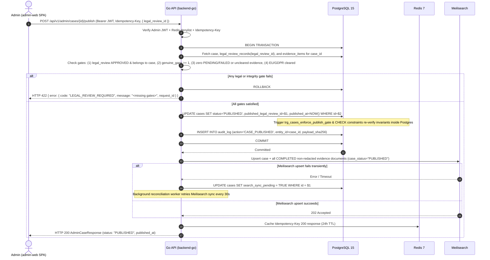

# Architecture Sequence Diagrams (`SD-1` – `SD-5`)

- **Document Path:** `docs/05-architecture/SEQUENCE_DIAGRAMS.md`
- **Phase:** Phase 06 — Architecture (Charter PART 05)
- **Traceability:** `HIGH_LEVEL_DESIGN.md`, `LOW_LEVEL_DESIGN.md`, `DATABASE_DESIGN.md`, `openapi.yaml`, `SECURITY_ARCHITECTURE.md`
- **Status:** Draft for PO Audit

---

## SD-1: Reader Fetches a Published Case

Illustrates anonymous reader ingress (`ADR-007`), reverse-proxy header sanitization (`T8`), server-side EU/EEA geoblock middleware (`ADR-008`, `ADR-015`), Redis rate limiting, and uniform `HTTP 404` protection against draft enumeration (`T1`).

```mermaid
sequenceDiagram
    autonumber
    actor Reader as Anonymous Reader (PWA)
    participant Proxy as Reverse Proxy
    participant Go as Go API (backend-go)
    participant Redis as Redis 7
    participant PG as PostgreSQL 15

    Reader->>Proxy: GET /api/v1/cases/{slug}
    Proxy->>Proxy: Strip untrusted X-Forwarded-For / CF-IPCountry; inject verified client IP
    Proxy->>Go: Forward request + verified IP / country header

    Go->>Go: Geoblock middleware checks ISO country code against 30-country EU/EEA list
    alt Country is in EU/EEA
        Go-->>Proxy: HTTP 451 { error: { code: "REGION_UNAVAILABLE", request_id } }
        Proxy-->>Reader: HTTP 451 ("Not available in your region")
    else Non-EU/EEA region
        Go->>Redis: Sliding-window rate-limit check (120 req/min/IP)
        alt Rate limit exceeded
            Redis-->>Go: Limit exceeded (retry_after_sec)
            Go-->>Reader: HTTP 429 + Retry-After header
        else Allowed (or local fallback if Redis down)
            Go->>PG: SELECT case WHERE slug = $1 AND status = 'PUBLISHED'
            alt Not found OR status in (DRAFT, IN_REVIEW, APPROVED, RETRACTED)
                PG-->>Go: 0 rows
                Go-->>Reader: HTTP 404 { error: { code: "NOT_FOUND", request_id } }
            else Published case found
                Go->>PG: SELECT evidence_items (non-redacted summary) & case_timeline_events ORDER BY event_start_date, sort_order
                PG-->>Go: Evidence summaries + Timeline + Genuine Gaps + Corrections Log
                Go->>Go: Compute 4x3 Verification Tier x License Status warning_level badges
                Go-->>Reader: HTTP 200 CaseDetail JSON (zero Set-Cookie headers)
            end
        end
    end
```

---

## SD-2: Reader Searches, Hits Meilisearch, Gets Evidence from Go, Hits Postgres

Illustrates full-text search over extracted/OCRed evidence (`ADR-012`), strict allowlist filter construction preventing query-string injection (`T5`), and subsequent evidence inspection with short-lived pre-signed S3 URL minting (`ADR-013`).

```mermaid
sequenceDiagram
    autonumber
    actor Reader as Anonymous Reader (PWA)
    participant Go as Go API (backend-go)
    participant Meili as Meilisearch
    participant PG as PostgreSQL 15
    participant S3 as S3-Compatible Storage

    Reader->>Go: GET /api/v1/search?q=shell+corp&category=financial_crime&verification_tier=1
    Go->>Go: Geoblock (EU/EEA -> 451) & Rate Limit (30 req/min/IP)
    Go->>Go: Validate q (<=200 chars) & facet enums; build typed filter ["case_status = \"PUBLISHED\"", "category = \"financial_crime\"", "verification_tier = 1"]
    Go->>Meili: POST /indexes/published_content/search (structured JSON q + filter, 2s timeout)

    alt Meilisearch unreachable or timeout
        Meili--xGo: Timeout / Connection Refused
        Go-->>Reader: HTTP 503 { error: { code: "SEARCH_UNAVAILABLE", request_id } }
    else Search succeeds
        Meili-->>Go: Ranked hits (case_slug, evidence_id, highlighted snippets)
        Go-->>Reader: HTTP 200 { data: [...], next_cursor, has_more }
    end

    Note over Reader,S3: Reader taps a matching evidence hit to inspect the primary PDF
    Reader->>Go: GET /api/v1/evidence/{id}
    Go->>PG: SELECT e.*, c.status, l.credit_line FROM evidence_items e JOIN cases c ... WHERE e.id = $1 AND c.status = 'PUBLISHED'
    alt Parent case not PUBLISHED or item missing
        PG-->>Go: 0 rows
        Go-->>Reader: HTTP 404 { error: { code: "NOT_FOUND", request_id } }
    else Evidence is_redacted = TRUE
        PG-->>Go: Redacted metadata row
        Go-->>Reader: HTTP 200 EvidenceDetail (is_redacted: true, signed_file_url: null)
    else Active published evidence
        PG-->>Go: Evidence metadata + object_key + sha256_hash + source_citation
        Go->>S3: Presign GetObject(object_key, TTL=300s, Content-Type)
        S3-->>Go: Short-lived signed_file_url
        Go-->>Reader: HTTP 200 EvidenceDetail (metadata + warning_level + signed_file_url)
        Reader->>S3: Direct GET signed_file_url (renders PDF/image in sandboxed viewer)
        S3-->>Reader: Binary PDF/image stream
    end
```

---

## SD-3: Admin Uploads Evidence → Redis Stream → Rust Processes → Go Updates DB → Meilisearch Indexes

Illustrates Q5 and 4×3 Evidence Integrity enforcement, `Idempotency-Key` deduplication, isolated Rust PDF/OCR processing (`ADR-011`), at-least-once delivery with retries/DLQ, and conditional Meilisearch indexing (never indexing unpublished drafts).

```mermaid
sequenceDiagram
    autonumber
    actor Admin as Admin (admin-web SPA)
    participant Go as Go API (backend-go)
    participant S3 as S3-Compatible Storage
    participant PG as PostgreSQL 15
    participant Redis as Redis 7 Streams
    participant Rust as Rust Processor (processor-rust)
    participant Meili as Meilisearch

    Admin->>Go: POST /api/v1/admin/cases/{id}/evidence (Bearer JWT, Idempotency-Key, multipart file + metadata)
    Go->>Go: Verify Admin JWT + Redis denylist + Idempotency-Key cache
    Go->>Go: Validate 4x3 Matrix & Q5: NOT (source_type='third_party_exhibit' AND license_status='PUBLIC_DOMAIN')

    alt Violates Q5, 4x3 Matrix, or missing licensing_record_id / recreation fields
        Go-->>Admin: HTTP 400 { error: { code: "Q5_VIOLATION|RECREATED_TIER_TOO_HIGH|LICENSING_RECORD_REQUIRED|RECREATION_FIELDS_REQUIRED", request_id } }
    else Policy valid & file <= 25 MB
        Go->>Go: Stream bytes -> compute SHA-256 -> generate UUID storage_key (ignore client filename)
        Go->>S3: PutObject(storage_key, bytes)
        S3-->>Go: 200 OK
        Go->>PG: BEGIN; INSERT evidence_items (processing_status='PENDING', Q5 CHECK enforced) + INSERT audit_log; COMMIT
        PG-->>Go: Created evidence_id
        Go->>Redis: XADD evidence.process MAXLEN ~ 10000 { job_id, evidence_id, storage_key, mime_type, case_id }
        Go->>Redis: Cache Idempotency-Key response (24h TTL)
        Go-->>Admin: HTTP 202 { evidence_id, processing_status: "PENDING", job_published: true, sha256_hash, storage_key }
    end

    Note over Redis,Rust: Asynchronous Document Extraction Pipeline
    Rust->>Redis: XREADGROUP GROUP processor-workers COUNT 1 BLOCK 5000 STREAMS evidence.process >
    Redis-->>Rust: Job payload (job_id, evidence_id, storage_key, mime_type, case_id)
    Rust->>S3: GetObject(storage_key)
    S3-->>Rust: Raw file bytes
    Rust->>Rust: Validate & parse PDF text -> OCR fallback via tesseract subprocess if scanned

    alt Extraction succeeds
        Rust->>PG: UPDATE evidence_items SET processing_status='COMPLETED', extracted_text, page_count, ocr_used, last_processed_job_id
        Rust->>Redis: XACK evidence.process processor-workers <msg_id>
    else Permanent error (corrupt PDF, unsupported mime, OCR unavailable) OR retries > 3
        Rust->>PG: UPDATE evidence_items SET processing_status='FAILED', last_processed_job_id + INSERT audit_log (evidence.processing_failed)
        Rust->>Redis: XADD evidence.process.dead { job_id, evidence_id, storage_key, mime_type, case_id, error_reason }
        Rust->>Redis: XACK evidence.process processor-workers <msg_id>
    end

    Note over Go,Meili: Publish-Time Meilisearch Indexing (Drafts Never Indexed)
    alt Parent case status == 'PUBLISHED' AND status == 'COMPLETED'
        Go->>Meili: Upsert evidence document (case_status: "PUBLISHED", extracted_text)
        Meili-->>Go: 202 Accepted
    else Parent case is DRAFT / IN_REVIEW / APPROVED
        Go->>Go: Skip Meilisearch indexing (drafts never enter public search index)
    end
```

---

## SD-4: Admin Publishes a Case (Hard Legal-Review Gate)

Illustrates the mandatory pre-publication legal review gate (`REQ-027`, `REQ-028`), database trigger defense-in-depth, atomic audit logging, and Meilisearch publication indexing.



---

## SD-5: Correction Request Submission & Async Triage (No Email at MVP)

Illustrates anonymous correction/takedown submission (`REQ-030`), anti-spam honeypot + rate-limiting (`T4`), PostgreSQL persistence without an email service at MVP, and Admin dashboard review (including optional escalation to the emergency kill-switch `REQ-031`).

```mermaid
sequenceDiagram
    autonumber
    actor Submitter as Anonymous Submitter (Reader / Journalist)
    participant Go as Go API (backend-go)
    participant Redis as Redis 7
    participant PG as PostgreSQL 15
    actor Admin as Admin (admin-web SPA)
    participant Meili as Meilisearch

    Submitter->>Go: POST /api/v1/corrections (Idempotency-Key, { case_slug, request_type, email, description, website })
    Go->>Go: Geoblock (EU/EEA -> 451)
    Go->>Redis: Check IP rate limit (<= 5 req/hour) & Idempotency-Key

    alt Redis down
        Go-->>Submitter: HTTP 503 { error: { code: "SERVICE_UNAVAILABLE", request_id } }
    else Rate limit exceeded
        Go-->>Submitter: HTTP 429 + Retry-After
    else Honeypot field `website` is non-empty (Bot detected)
        Go-->>Submitter: HTTP 201 synthetic ticket_id (dropped; nothing written to PG)
    else Legitimate request
        Go->>Go: Generate unique ticket_id (CORR-YYYYMMDD-XXXXXX)
        Go->>PG: BEGIN; INSERT correction_requests (status='OPEN'); INSERT audit_log (action='CORRECTION_SUBMITTED', zero PII); COMMIT
        PG-->>Go: Persisted
        Go->>Redis: Cache Idempotency-Key 201 response (24h TTL)
        Go-->>Submitter: HTTP 201 { ticket_id, status: "OPEN", created_at }
    end

    Note over PG,Admin: No outbound email service at MVP — Admin polls/views open requests directly in Admin Web
    Admin->>Go: View open correction requests in Admin Web (Bearer JWT)
    Go->>PG: SELECT * FROM correction_requests WHERE status = 'OPEN' ORDER BY created_at ASC
    PG-->>Go: Open correction tickets
    Go-->>Admin: Render triage queue in Admin Web

    opt Valid urgent defamation/copyright/privacy takedown
        Admin->>Go: POST /api/v1/admin/cases/{id}/retract ({ reason_code, reason_detail })
        Go->>PG: BEGIN; UPDATE cases SET status='RETRACTED', retracted_at=NOW(); INSERT audit_log; COMMIT
        Go->>Meili: DELETE case & evidence docs from published_content index (retry every 5s if unreachable)
        Go-->>Admin: HTTP 200 (Case removed from public API & search <= 60s)
    end
```
