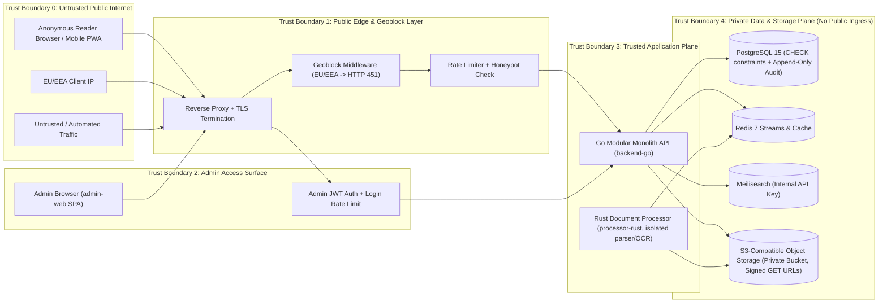

# System Context (C4 Level 1)

- **Document Path:** `docs/05-architecture/SYSTEM_CONTEXT.md`
- **Phase:** Phase 06 — Architecture (Charter PART 05)
- **Traceability:** `PRODUCT_REQUIREMENTS.md`, `EVIDENCE_INTEGRITY_SPEC.md`, `ADR-003`, `ADR-006`, `ADR-007`, `ADR-008`, `ADR-009`, `ADR-010`–`ADR-015`
- **Status:** Draft for PO Audit

---

## 1. System Purpose & Scope

The **True Crime Investigation Platform** is a legally defensible, primary-source investigative dossier application focused at launch on **10 US public-record cases** (6 financial crime / money laundering cases from DOJ/SEC/IRS/FinCEN/PACER records and 4 historical public-record cases). Every published assertion is governed by the four-tier Evidence Integrity Contract (`EVIDENCE_INTEGRITY_SPEC.md`), a hard legal-review publication gate (`REQ-027`), and database-enforced third-party exhibit copyright protection (PO Decision Q5).

Per PO architectural decisions (`ADR-006`–`ADR-015`), the MVP and v1.0 launch system ships as an **anonymous-reading-only mobile-first PWA** (with EU/EEA traffic geoblocked at the edge/middleware layer) paired with a separate **Admin Web SPA** used solely by the solo founder (and optional internal researcher role) to author, verify, legally sign off, and publish dossiers.

---

## 2. C4 Level 1 — System Context Diagram

```mermaid
C4Context
    title System Context — True Crime Investigation Platform (MVP / v1.0)

    Person(reader, "Anonymous Reader (Non-EU/EEA)", "Reads published dossiers, inspects primary PDFs/images, explores timelines, searches extracted text, and submits public correction requests. No account or login (ADR-007).")
    Person(eu_visitor, "EU/EEA Visitor", "Blocked at IP/geoblock middleware layer (HTTP 451 static notice) until GDPR counsel is funded (ADR-008).")
    Person(admin, "Admin (Solo Founder)", "Authenticates via JWT into Admin Web to author cases, upload evidence, record external legal sign-off, publish, retract, and triage correction requests.")
    Person(researcher, "PO-as-Researcher", "Assembles FOIA/PACER/DOJ/SEC primary files, classifies Verification Tier & License Status, builds timelines & Genuine Gaps, and submits drafts for legal review.")

    System_Boundary(platform_boundary, "True Crime Investigation Platform (System Boundary)") {
        System(reader_pwa, "Reader PWA (mobile-web)", "Installable, offline-capable React + Vite + Tailwind mobile-first reader client (ADR-014).")
        System(admin_web, "Admin Web (admin-web)", "Separate React + Vite + Tailwind authoring SPA for case/evidence/legal workflows (ADR-006).")
        System(go_api, "Go Modular Monolith API (backend-go)", "Public reader API, geoblock & rate-limit middleware, JWT-protected admin API, publication state machine, signed URL broker, Meili indexer (ADR-010, ADR-015).")
        System(rust_proc, "Rust Document Processor (processor-rust)", "Consumes evidence jobs from Redis Streams; performs PDF parsing, OCR, SHA-256 verification, and text extraction.")
        SystemDb(postgres, "PostgreSQL 15", "Durable source of truth: cases, evidence_items (with Q5 CHECK constraint), timelines, licensing, legal reviews, append-only audit_log, correction_requests.")
        SystemQueue(redis, "Redis 7 (Streams & Ephemeral Store)", "Job queue via Redis Streams (ADR-011), rate-limit counters, Idempotency-Key cache, and JWT revocation denylist.")
        SystemDb(meili, "Meilisearch", "Self-hosted typo-tolerant full-text search index over published cases, extracted PDF text, and OCR output (ADR-012).")
        SystemDb(obj_store, "S3-Compatible Object Storage", "Stores immutable raw evidence PDFs/images/recreations behind an S3 interface; provider deferred (ADR-013).")
    }

    System_Ext(github, "GitHub (mahitss/evidence_architecture)", "Remote source of truth for source code, ADRs, architecture docs, CI workflows (with Docker service containers).")
    System_Ext(public_sources, "US Public Record Sources (Manual)", "PACER, CourtListener, DOJ/SEC/IRS/FinCEN releases, FBI Wanted, MuckRock FOIA (manually curated by PO — $0 paid APIs).")
    System_Ext(legal_counsel, "External Legal Counsel (Offline)", "US media/First Amendment attorney reviewing disclaimers, correction flow, and Case 1; issues external sign-off reference recorded by Admin.")
    System_Ext(future_email, "Email / Notification Provider (DEFERRED)", "Explicitly NOT integrated at MVP/v1.0. Correction requests persist in PostgreSQL and are reviewed in Admin Web.")

    Rel(reader, reader_pwa, "Browses cases, views timelines/evidence, searches, submits corrections", "HTTPS")
    Rel(eu_visitor, go_api, "Intercepted by IP geoblock middleware", "HTTPS -> HTTP 451")
    Rel(admin, admin_web, "Authors cases, uploads files, records legal review, publishes/retracts", "HTTPS + Admin JWT")
    Rel(researcher, admin_web, "Drafts dossiers, tags evidence tiers/licenses, builds timelines", "HTTPS + Admin JWT")
    Rel(researcher, public_sources, "Retrieves primary filings & FOIA records manually", "Manual / HTTPS")
    Rel(admin, legal_counsel, "Sends draft dossiers & templates for sign-off", "Offline / External")

    Rel(reader_pwa, go_api, "Calls public /api/v1/* endpoints", "HTTPS / JSON")
    Rel(admin_web, go_api, "Calls /api/v1/admin/* endpoints", "HTTPS / JSON + Multipart")
    Rel(go_api, postgres, "Reads/writes authoritative records", "TCP / SQL (TLS in prod)")
    Rel(go_api, redis, "Publishes evidence jobs, consumes results, enforces rate limits & idempotency", "TCP / RESP")
    Rel(go_api, meili, "Queries published index & pushes/deletes indexed documents", "HTTP / JSON")
    Rel(go_api, obj_store, "Uploads evidence blobs & mints short-lived pre-signed GET URLs", "S3 API / HTTPS")
    Rel(rust_proc, redis, "Consumes evidence:jobs & publishes evidence:results / evidence:dlq", "TCP / RESP")
    Rel(rust_proc, obj_store, "Downloads raw uploaded PDFs/images for parsing & OCR", "S3 API / HTTPS")
    Rel(admin, github, "Pushes code/docs & triggers CI pipelines", "HTTPS / Git")
    Rel(go_api, future_email, "Deferred post-MVP (no integration at launch)", "None at MVP")
```

---

## 3. Actors & External Systems

### External Actors

| Actor | Role in System | Authentication | Access Surface |
|---|---|---|---|
| **Anonymous Reader (Non-EU/EEA)** | Consumes published cases, Official Briefings, Genuine Gaps, timelines, primary PDFs/images, search, and submits correction/takedown requests (`REQ-001`–`REQ-012`, `REQ-014`, `REQ-030`). | None (`ANONYMOUS` — `ADR-007`) | Reader PWA (`mobile-web`) + Public `/api/v1/*` |
| **EU/EEA Visitor** | Explicitly excluded from reading at launch due to unfunded GDPR compliance (`ADR-008`). | None | Intercepted by geoblock middleware; receives static *"Not available in your region"* page (`HTTP 451`) |
| **Admin (Solo Founder)** | Owns system governance, legal sign-off recording, case publication, emergency retraction, evidence deletion, and correction triage (`REQ-023`–`REQ-032`). | Internal Admin JWT (`admin_users` table; `ADR-007`) | Admin Web (`admin-web`) + `/api/v1/admin/*` |
| **PO-as-Researcher** | In MVP/v1.0, the solo founder wears the researcher hat (manually gathering US public records from PACER/DOJ/SEC/MuckRock, authoring drafts, verifying SHA-256 provenance). Designed so a future non-admin `RESEARCHER` role can be separated without schema rework. | Internal Admin JWT (single admin at MVP; `RESEARCHER` role reserved) | Admin Web (`admin-web`) + `/api/v1/admin/*` |

### External Systems

| System | Relationship | Status at MVP / v1.0 | Failure Mode if Unavailable |
|---|---|---|---|
| **GitHub (`mahitss/evidence_architecture`)** | Authoritative repository for code, ADRs, docs, and CI workflows (using Docker service containers in GitHub Actions). | Active | Blocks CI/deployments; **zero runtime impact** on live Reader PWA or Go API. |
| **S3-Compatible Object Storage** | Stores immutable raw evidence PDFs, images, and recreated visuals behind a Go/Rust storage interface (`ADR-013`); specific vendor deferred. | Active via interface (local filesystem/S3-compatible emulator in dev; cloud provider chosen prior to staging) | Reader cannot fetch signed evidence binaries (`HTTP 503` on file fetch while metadata/briefings remain readable from Postgres); Admin uploads fail cleanly with `HTTP 503` and no orphaned DB row. |
| **Meilisearch** | Self-hosted search engine indexing published case metadata, extracted PDF text, and OCR output (`ADR-012`). | Active (self-hosted container/binary) | `GET /api/v1/search` returns `HTTP 503` (`SEARCH_UNAVAILABLE`) with clear user message; case browsing, timelines, and evidence viewing via PostgreSQL continue unaffected. Index is 100% rebuildable from PostgreSQL. |
| **US Public Record Sources** | PACER, CourtListener, DOJ/SEC/IRS/FinCEN releases, FBI Wanted, MuckRock FOIA. | Manual offline curation (`$0` paid APIs) | Delays new case research only; **zero runtime dependency** because approved primary records are archived in our own object storage. |
| **External Legal Counsel** | US media/First Amendment lawyer reviewing templates, correction process, and Case 1. | External human workflow | Publication gate (`REQ-027`) blocks `POST /api/v1/admin/cases/{id}/publish` (`HTTP 422`) until a signed `legal_review_records` entry is recorded; prevents unvetted launches. |
| **Email / Notification Provider** | Outbound notification for correction acknowledgments and founder alerts. | **Explicitly Deferred** at MVP/v1.0 | N/A at MVP — correction requests are persisted synchronously in PostgreSQL `correction_requests` and reviewed directly in Admin Web (`SD-5`). |

---

## 4. What Is Inside vs. Outside the System

### Inside the System Boundary (MVP / v1.0)
1. **Reader PWA (`mobile-web`)** — Installable, offline-capable React + Vite + Tailwind SPA (`ADR-014`).
2. **Admin Web (`admin-web`)** — Separate React + Vite + Tailwind authoring SPA (`ADR-006`).
3. **Go API (`backend-go`)** — Modular monolith handling public reader API, geoblock middleware, admin API, legal publication state machine, Redis Streams producer/result-consumer, and Meilisearch sync (`ADR-010`, `ADR-015`).
4. **Rust Document Processor (`processor-rust`)** — Dedicated worker consuming `evidence:jobs` from Redis Streams for safe PDF parsing, OCR, and text extraction.
5. **PostgreSQL 15** — Authoritative relational datastore with strict `CHECK` constraints (including Q5) and append-only `audit_log`.
6. **Redis 7** — Redis Streams job queue (`ADR-011`), rate limiting, idempotency keys, and JWT revocation denylist.
7. **Meilisearch** — Self-hosted search engine (`ADR-012`).
8. **S3-Compatible Object Storage** — Binary evidence storage accessed via interface (`ADR-013`).

### Explicitly Outside the System Boundary (MVP / v1.0)
- Consumer user accounts, registration, login, bookmarks, personalization (`ADR-007` — deferred to v1.1).
- Community theories UI, public submission endpoints, moderation queue (`ADR-009` — deferred to v1.1).
- Billing, subscriptions, and payment gateways (`PO_SCOPING_DECISIONS.md` #2 — Domain 21 out of scope).
- Native mobile iOS/Android Tauri builds (`ADR-003`, `ADR-014` — deferred).
- Email delivery service (deferred; DB-backed admin triage at MVP).
- Paid third-party APIs or external CDN at MVP (`PO_SCOPING_DECISIONS.md` #4).

---

## 5. Trust Boundaries

### Trust Boundary Enforcement & Failure Modes
1. **TB0 → TB1 (Untrusted Internet → Public Edge):** All ingress terminates TLS and passes through EU/EEA GeoIP inspection (`ADR-008`) and IP rate limiting before reaching business logic. *Failure mode:* If the GeoIP lookup fails or returns an unknown/error state on the reader surface, the middleware **fails open or closed per config** — specifically, **fail-closed for missing GeoIP database at startup** (server refuses to start in `prod` without a valid GeoIP DB/header config) and logs lookup anomalies for unknown IPs without leaking draft data.
2. **TB1 → TB3 (Public Reader vs. Admin Surface):** Public endpoints (`/api/v1/cases`, `/evidence`, `/search`, `/corrections`) execute read-only queries filtered unconditionally by `status = 'PUBLISHED'`. Admin endpoints (`/api/v1/admin/*`) require a valid, non-revoked Admin JWT signed with server-side secret. *Failure mode:* If JWT verification or Redis denylist lookup fails, admin endpoints **fail closed (`HTTP 401`/`503`)** — never allowing unauthenticated fallback.
3. **TB3 (Go API vs. Rust Document Processor):** Untrusted PDF/image files uploaded by Admin are **never parsed inside the Go API process**. Go streams raw bytes directly to private S3-compatible storage and publishes a job to Redis Streams; `processor-rust` parses/OCRs the file in a separate OS process with strict memory/CPU/timeout bounds. *Failure mode:* If a malformed or hostile PDF crashes or OOMs a Rust worker, the Go API remains completely unaffected; the job retries up to 3 times and moves to `evidence:dlq` while the evidence item stays in `PROCESSING_FAILED` (never publicly visible).
4. **TB3 → TB4 (Application Plane → Private Data Plane):** PostgreSQL, Redis, Meilisearch, and the private S3 bucket are bound strictly to localhost (`127.0.0.1` in local sandbox per `ADR-005`) or private VPC/internal interface in staging/production—never exposed to the public internet. Readers never receive S3 credentials; they receive short-lived pre-signed GET URLs (`<= 5 minutes` TTL) minted by Go strictly for `PUBLISHED`, non-retracted evidence items.
