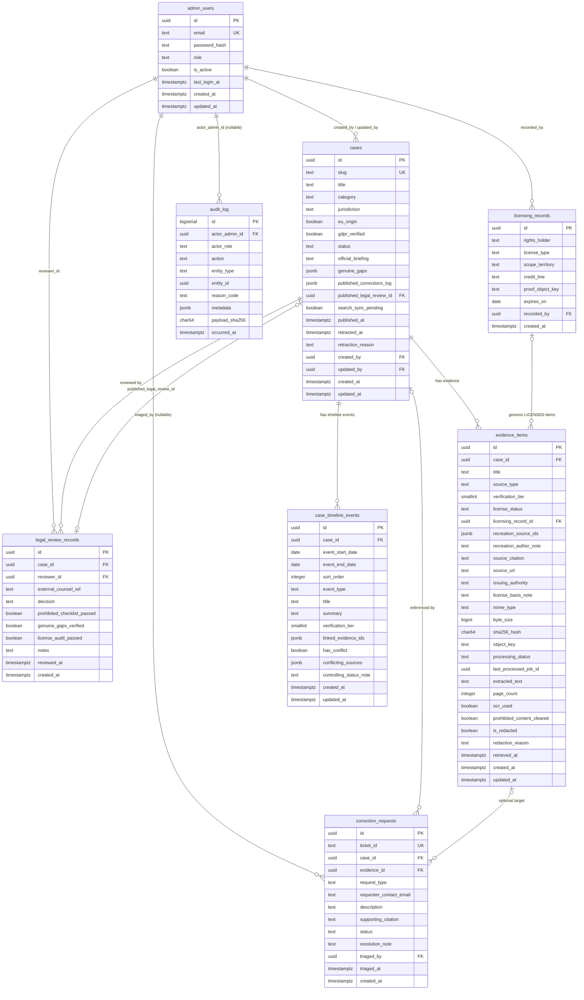

# Database Design & Entity-Relationship Specification

- **Document Path:** `docs/08-database/DATABASE_DESIGN.md`
- **Phase:** Phase 06 — Architecture (Charter PART 05)
- **Engine:** PostgreSQL 15 (`15.20` verified in local sandbox; `ADR-005`)
- **Traceability:** `PRODUCT_REQUIREMENTS.md`, `EVIDENCE_INTEGRITY_SPEC.md`, `ADR-005`, `ADR-007`, `ADR-009`, `ADR-010`, `ADR-012`, `ADR-013`
- **Scope Note:** Design specification only — **no SQL migration files are created in Phase 06** (deferred to Prompt 8).

---

## 1. Explicit v1.0 Exclusions (`ADR-007`, `ADR-009`)

- **NO consumer user tables at v1.0 (`ADR-007`):** There is NO `users`, `user_sessions`, `bookmarks`, or `consent_records` table in MVP or v1.0. Public reading is strictly anonymous. Only `admin_users` exists for internal operational authoring. Consumer accounts move to v1.1 gated on funded India DPDP legal counsel.
- **NO community tables deployed at v1.0 (`ADR-009`):** `community_theories`, `theory_evidence_citations`, `theory_reports`, and `moderation_audit` are **NOT** created in v1.0 migrations and have zero API/UI surface at launch. Section 7 reserves their decoupled v1.1 foreign-key design (`case_id`, `evidence_id`) so v1.1 requires zero breaking changes to core tables.

---

## 2. Entity-Relationship Diagram (ERD — v1.0 Core Schema)

---

## 3. Mandatory `CHECK` Constraints & Database Invariants

Every core legal and evidentiary guarantee is enforced inside PostgreSQL itself so a bug in an API handler, migration script, or admin tool cannot corrupt legal defensibility.

1. **`evidence_items.license_status` Domain Constraint:**
   - `license_status TEXT NOT NULL CHECK (license_status IN ('PUBLIC_DOMAIN', 'LICENSED', 'RECREATED'))`
2. **`evidence_items.verification_tier` Domain Constraint:**
   - `verification_tier SMALLINT NOT NULL CHECK (verification_tier IN (1, 2, 3, 4))`
3. **Q5 Hard Copyright Constraint (Verbatim per PO Decision Q5 & `EVIDENCE_INTEGRITY_SPEC.md §2`):**
   - `CONSTRAINT chk_q5_no_public_domain_third_party_exhibit CHECK (NOT (source_type = 'third_party_exhibit' AND license_status = 'PUBLIC_DOMAIN'))`
   - *Failure mode:* Any `INSERT` or `UPDATE` attempting to mark a `third_party_exhibit` as `PUBLIC_DOMAIN` raises PostgreSQL SQLSTATE `23514` (`check_violation`), rolled back atomically and translated by Go into `HTTP 422` (`EVIDENCE_POLICY_BLOCKED`).
4. **4×3 Evidence Integrity Matrix Hard Blocks (`EVIDENCE_INTEGRITY_SPEC.md §3`):**
   - `CONSTRAINT chk_no_recreated_tier3_tier4 CHECK (NOT (verification_tier IN (3, 4) AND license_status = 'RECREATED'))`
   - `CONSTRAINT chk_licensed_requires_record CHECK (license_status <> 'LICENSED' OR licensing_record_id IS NOT NULL)`
   - `CONSTRAINT chk_recreated_requires_sources CHECK (license_status <> 'RECREATED' OR (recreation_source_ids IS NOT NULL AND jsonb_typeof(recreation_source_ids) = 'array' AND jsonb_array_length(recreation_source_ids) >= 1))`
5. **`cases.status` State Domain Constraint:**
   - `status TEXT NOT NULL CHECK (status IN ('DRAFT', 'IN_REVIEW', 'APPROVED', 'PUBLISHED', 'RETRACTED'))`
6. **EU-Origin GDPR Gate (`REQ-028`, `ADR-008`):**
   - `CONSTRAINT chk_eu_origin_requires_gdpr CHECK (status NOT IN ('IN_REVIEW', 'APPROVED', 'PUBLISHED') OR NOT (eu_origin = TRUE AND gdpr_verified = FALSE))`
7. **Mandatory Legal-Review Publication Gate (`REQ-027`):**
   - **Table-level `CHECK` + FK:**
     - `published_legal_review_id UUID REFERENCES legal_review_records(id) ON DELETE RESTRICT`
     - `CONSTRAINT chk_published_requires_legal_review CHECK (status <> 'PUBLISHED' OR (published_legal_review_id IS NOT NULL AND published_at IS NOT NULL AND jsonb_typeof(genuine_gaps) = 'array' AND jsonb_array_length(genuine_gaps) >= 1))`
   - **Database `BEFORE INSERT OR UPDATE` Trigger (`trg_cases_enforce_publish_gate`):**
     - Whenever `NEW.status = 'PUBLISHED'`, verifies atomically inside PostgreSQL that:
       1. A `legal_review_records` row exists where `id = NEW.published_legal_review_id`, `case_id = NEW.id`, `reviewer_id IS NOT NULL`, `reviewed_at IS NOT NULL`, `decision = 'APPROVED'`, and `prohibited_checklist_passed = TRUE`.
       2. Zero `evidence_items` for `case_id = NEW.id` have `prohibited_content_cleared = FALSE` or `processing_status <> 'COMPLETED'`.
     - *Failure mode:* Raises `SQLSTATE 'P0001'` (`publish_gate_violation`), aborting the transaction before any case row can become `PUBLISHED`.

---

## 4. Table Definitions, Columns, Defaults & Indexes

### 4.1 `admin_users` *(Internal operational table only — NO public/consumer users)*

| Column | Type | Nullable | Default | Constraints / Notes |
|---|---|---|---|---|
| `id` | `UUID` | NOT NULL | `gen_random_uuid()` | Primary Key |
| `email` | `TEXT` | NOT NULL | — | `UNIQUE` (case-insensitive unique index on `LOWER(email)`) |
| `password_hash` | `TEXT` | NOT NULL | — | Argon2id PHC string (`$argon2id$...`) |
| `role` | `TEXT` | NOT NULL | `'ADMIN'` | `CHECK (role IN ('ADMIN', 'RESEARCHER'))` — single `ADMIN` seeded at MVP |
| `is_active` | `BOOLEAN` | NOT NULL | `TRUE` | Inactive accounts cannot authenticate |
| `last_login_at` | `TIMESTAMPTZ` | NULL | `NULL` | Updated on successful admin login |
| `created_at` | `TIMESTAMPTZ` | NOT NULL | `NOW()` | UTC |
| `updated_at` | `TIMESTAMPTZ` | NOT NULL | `NOW()` | UTC |

- **Indexes:** `PK (id)`, `UNIQUE INDEX idx_admin_users_email_lower ON admin_users (LOWER(email))`.

---

### 4.2 `cases`

| Column | Type | Nullable | Default | Constraints / Notes |
|---|---|---|---|---|
| `id` | `UUID` | NOT NULL | `gen_random_uuid()` | Primary Key |
| `slug` | `TEXT` | NOT NULL | — | `UNIQUE`, `CHECK (slug ~ '^[a-z0-9]+(?:-[a-z0-9]+)*$')` |
| `title` | `TEXT` | NOT NULL | — | `CHECK (length(trim(title)) BETWEEN 3 AND 200)` |
| `category` | `TEXT` | NOT NULL | — | `CHECK (category IN ('financial_crime', 'historical_public_record'))` *(launch categories; expandable via migration in v1.1)* |
| `jurisdiction` | `TEXT` | NOT NULL | `'US'` | E.g., `US-FEDERAL`, `US-NY`, `US-TX` |
| `eu_origin` | `BOOLEAN` | NOT NULL | `FALSE` | Blocks review/publish unless `gdpr_verified = TRUE` |
| `gdpr_verified` | `BOOLEAN` | NOT NULL | `FALSE` | Must remain `FALSE` at launch (`ADR-008`) |
| `status` | `TEXT` | NOT NULL | `'DRAFT'` | `CHECK (status IN ('DRAFT','IN_REVIEW','APPROVED','PUBLISHED','RETRACTED'))` |
| `official_briefing` | `TEXT` | NOT NULL | `''` | Markdown/structured Tier-1-backed briefing |
| `genuine_gaps` | `JSONB` | NOT NULL | `'[]'::jsonb` | Array of `{ claim, why_unverified, highest_available_tier, citation_url? }`; `>= 1` item required when `PUBLISHED` |
| `published_corrections_log` | `JSONB` | NOT NULL | `'[]'::jsonb` | Public post-publication corrections (`REQ-032`) |
| `published_legal_review_id` | `UUID` | NULL | `NULL` | `REFERENCES legal_review_records(id) ON DELETE RESTRICT`; NOT NULL when `status = 'PUBLISHED'` |
| `search_sync_pending` | `BOOLEAN` | NOT NULL | `FALSE` | Set `TRUE` when Meilisearch upsert/delete fails transiently; drained by Go reconciliation worker |
| `published_at` | `TIMESTAMPTZ` | NULL | `NULL` | Set upon first/latest publish |
| `retracted_at` | `TIMESTAMPTZ` | NULL | `NULL` | Set upon emergency kill-switch (`REQ-031`) |
| `retraction_reason` | `TEXT` | NULL | `NULL` | Required when `status = 'RETRACTED'` |
| `created_by` | `UUID` | NOT NULL | — | `REFERENCES admin_users(id) ON DELETE RESTRICT` |
| `updated_by` | `UUID` | NOT NULL | — | `REFERENCES admin_users(id) ON DELETE RESTRICT` |
| `created_at` | `TIMESTAMPTZ` | NOT NULL | `NOW()` | UTC |
| `updated_at` | `TIMESTAMPTZ` | NOT NULL | `NOW()` | UTC |

- **Indexes:**
  - `PK (id)`
  - `UNIQUE INDEX idx_cases_slug ON cases (slug)`
  - `INDEX idx_cases_published_catalog ON cases (category, published_at DESC, id DESC) WHERE status = 'PUBLISHED'` *(optimizes public cursor pagination)*
  - `INDEX idx_cases_search_sync ON cases (id) WHERE search_sync_pending = TRUE`

---

### 4.3 `licensing_records`

| Column | Type | Nullable | Default | Constraints / Notes |
|---|---|---|---|---|
| `id` | `UUID` | NOT NULL | `gen_random_uuid()` | Primary Key |
| `rights_holder` | `TEXT` | NOT NULL | — | Publisher / photographer / archive name |
| `license_type` | `TEXT` | NOT NULL | — | E.g., `CC-BY-4.0`, `DIRECT_WRITTEN_GRANT`, `ARCHIVAL_LICENSE` |
| `scope_territory` | `TEXT` | NOT NULL | `'WORLDWIDE'` | Permitted distribution scope |
| `credit_line` | `TEXT` | NOT NULL | — | Exact attribution string displayed under asset (`EVIDENCE_INTEGRITY_SPEC.md §2`) |
| `proof_object_key` | `TEXT` | NOT NULL | — | Private S3 key storing written permission / license PDF |
| `expires_on` | `DATE` | NULL | `NULL` | Optional license expiration date |
| `recorded_by` | `UUID` | NOT NULL | — | `REFERENCES admin_users(id) ON DELETE RESTRICT` |
| `created_at` | `TIMESTAMPTZ` | NOT NULL | `NOW()` | UTC |

- **Indexes:** `PK (id)`, `INDEX idx_licensing_records_expires ON licensing_records (expires_on) WHERE expires_on IS NOT NULL`.

---

### 4.4 `evidence_items`

| Column | Type | Nullable | Default | Constraints / Notes |
|---|---|---|---|---|
| `id` | `UUID` | NOT NULL | `gen_random_uuid()` | Primary Key |
| `case_id` | `UUID` | NOT NULL | — | `REFERENCES cases(id) ON DELETE RESTRICT` |
| `title` | `TEXT` | NOT NULL | — | Human-readable exhibit title |
| `source_type` | `TEXT` | NOT NULL | — | `CHECK (source_type IN ('gov_primary_record','court_opinion_or_order','third_party_exhibit','historical_public_domain','licensed_media','in_house_recreation'))` |
| `verification_tier` | `SMALLINT` | NOT NULL | — | `CHECK (verification_tier IN (1, 2, 3, 4))` |
| `license_status` | `TEXT` | NOT NULL | — | `CHECK (license_status IN ('PUBLIC_DOMAIN', 'LICENSED', 'RECREATED'))` |
| `licensing_record_id` | `UUID` | NULL | `NULL` | `REFERENCES licensing_records(id) ON DELETE RESTRICT`; NOT NULL when `license_status = 'LICENSED'` |
| `recreation_source_ids` | `JSONB` | NULL | `NULL` | Array of UUIDs/citations; non-empty array required when `license_status = 'RECREATED'` |
| `recreation_author_note` | `TEXT` | NULL | `NULL` | Required when `license_status = 'RECREATED'` |
| `source_citation` | `TEXT` | NOT NULL | — | Docket number / FOIA ref / agency citation (`CHECK (length(trim(source_citation)) > 0)`) |
| `source_url` | `TEXT` | NULL | `NULL` | Authoritative source URL when available |
| `issuing_authority` | `TEXT` | NOT NULL | — | E.g., `U.S. District Court S.D.N.Y.`, `SEC`, `DOJ` |
| `license_basis_note` | `TEXT` | NOT NULL | — | Legal basis (e.g., `17 U.S.C. § 105 federal officer work`) |
| `mime_type` | `TEXT` | NOT NULL | — | `CHECK (mime_type IN ('application/pdf','image/png','image/jpeg','text/plain'))` |
| `byte_size` | `BIGINT` | NOT NULL | — | `CHECK (byte_size > 0 AND byte_size <= 26214400)` *(25 MB ceiling)* |
| `sha256_hash` | `CHAR(64)` | NOT NULL | — | `CHECK (sha256_hash ~ '^[a-f0-9]{64}$')` |
| `object_key` | `TEXT` | NOT NULL | — | `UNIQUE`, immutable S3 storage path |
| `processing_status` | `TEXT` | NOT NULL | `'PENDING'` | `CHECK (processing_status IN ('PENDING','COMPLETED','FAILED'))` |
| `last_processed_job_id` | `UUID` | NULL | `NULL` | Idempotency guard for `evidence:results` consumer |
| `extracted_text` | `TEXT` | NULL | `NULL` | Text extracted/OCRed by `processor-rust` (source of truth for Meilisearch rebuilds) |
| `page_count` | `INTEGER` | NULL | `NULL` | `CHECK (page_count IS NULL OR page_count > 0)` |
| `ocr_used` | `BOOLEAN` | NOT NULL | `FALSE` | `TRUE` if OCR fallback ran |
| `prohibited_content_cleared` | `BOOLEAN` | NOT NULL | `FALSE` | Must be `TRUE` before parent case can publish (`REQ-028`) |
| `is_redacted` | `BOOLEAN` | NOT NULL | `FALSE` | Emergency single-item redaction (`REQ-031`) |
| `redaction_reason` | `TEXT` | NULL | `NULL` | Required when `is_redacted = TRUE` |
| `retrieved_at` | `TIMESTAMPTZ` | NOT NULL | — | Timestamp when primary record was retrieved |
| `created_at` | `TIMESTAMPTZ` | NOT NULL | `NOW()` | UTC |
| `updated_at` | `TIMESTAMPTZ` | NOT NULL | `NOW()` | UTC |

- **Table-Level Constraints:**
  - `chk_q5_no_public_domain_third_party_exhibit`: `CHECK (NOT (source_type = 'third_party_exhibit' AND license_status = 'PUBLIC_DOMAIN'))`
  - `chk_no_recreated_tier3_tier4`: `CHECK (NOT (verification_tier IN (3, 4) AND license_status = 'RECREATED'))`
  - `chk_licensed_requires_record`: `CHECK (license_status <> 'LICENSED' OR licensing_record_id IS NOT NULL)`
  - `chk_recreated_requires_sources`: `CHECK (license_status <> 'RECREATED' OR (recreation_source_ids IS NOT NULL AND jsonb_typeof(recreation_source_ids) = 'array' AND jsonb_array_length(recreation_source_ids) >= 1))`
- **Indexes:**
  - `PK (id)`
  - `UNIQUE INDEX idx_evidence_object_key ON evidence_items (object_key)`
  - `INDEX idx_evidence_case_id ON evidence_items (case_id, created_at ASC)`
  - `INDEX idx_evidence_case_sha256 ON evidence_items (case_id, sha256_hash)` *(detect duplicate uploads within a case)*
  - `INDEX idx_evidence_processing_pending ON evidence_items (processing_status) WHERE processing_status = 'PENDING'`

---

### 4.5 `case_timeline_events`

| Column | Type | Nullable | Default | Constraints / Notes |
|---|---|---|---|---|
| `id` | `UUID` | NOT NULL | `gen_random_uuid()` | Primary Key |
| `case_id` | `UUID` | NOT NULL | — | `REFERENCES cases(id) ON DELETE CASCADE` *(draft cleanup only; published cases protected at service/DB layer)* |
| `event_start_date` | `DATE` | NOT NULL | — | Chronological anchor date |
| `event_end_date` | `DATE` | NULL | `NULL` | Optional bounded date range; `CHECK (event_end_date IS NULL OR event_end_date >= event_start_date)` |
| `sort_order` | `INTEGER` | NOT NULL | `0` | Tie-breaker for same-day events |
| `event_type` | `TEXT` | NOT NULL | — | `CHECK (event_type IN ('filing','transaction','arrest','hearing','verdict','release','other'))` |
| `title` | `TEXT` | NOT NULL | — | Short event headline |
| `summary` | `TEXT` | NOT NULL | — | Factual summary attributed to cited evidence |
| `verification_tier` | `SMALLINT` | NOT NULL | — | `CHECK (verification_tier IN (1, 2, 3, 4))` |
| `linked_evidence_ids` | `JSONB` | NOT NULL | `'[]'::jsonb` | Array of `evidence_items.id` UUIDs (validated same-case by service/trigger) |
| `has_conflict` | `BOOLEAN` | NOT NULL | `FALSE` | Enables `Disputed Sources` UI badge (`REQ-010`) |
| `conflicting_sources` | `JSONB` | NOT NULL | `'[]'::jsonb` | Array of `{ source_name, verification_tier, source_date, excerpt, evidence_id? }`; `CHECK (NOT has_conflict OR jsonb_array_length(conflicting_sources) >= 2)` |
| `controlling_status_note` | `TEXT` | NULL | `NULL` | Neutral controlling judicial disposition callout (`EVIDENCE_INTEGRITY_SPEC.md §5`) |
| `created_at` | `TIMESTAMPTZ` | NOT NULL | `NOW()` | UTC |
| `updated_at` | `TIMESTAMPTZ` | NOT NULL | `NOW()` | UTC |

- **Indexes:**
  - `PK (id)`
  - `INDEX idx_timeline_case_order ON case_timeline_events (case_id, event_start_date ASC, sort_order ASC, id ASC)`
  - `INDEX idx_timeline_case_tier_type ON case_timeline_events (case_id, verification_tier, event_type)`

---

### 4.6 `legal_review_records`

| Column | Type | Nullable | Default | Constraints / Notes |
|---|---|---|---|---|
| `id` | `UUID` | NOT NULL | `gen_random_uuid()` | Primary Key |
| `case_id` | `UUID` | NOT NULL | — | `REFERENCES cases(id) ON DELETE RESTRICT` |
| `reviewer_id` | `UUID` | NOT NULL | — | `REFERENCES admin_users(id) ON DELETE RESTRICT` *(internal admin recording counsel sign-off)* |
| `external_counsel_ref` | `TEXT` | NOT NULL | — | External legal counsel sign-off ID / engagement memo reference (`REQ-027`) |
| `decision` | `TEXT` | NOT NULL | — | `CHECK (decision IN ('APPROVED', 'CHANGES_REQUESTED', 'REJECTED'))` |
| `prohibited_checklist_passed` | `BOOLEAN` | NOT NULL | `FALSE` | Must be `TRUE` for `APPROVED` |
| `genuine_gaps_verified` | `BOOLEAN` | NOT NULL | `FALSE` | Must be `TRUE` for `APPROVED` |
| `license_audit_passed` | `BOOLEAN` | NOT NULL | `FALSE` | Must be `TRUE` for `APPROVED` |
| `notes` | `TEXT` | NOT NULL | `''` | Non-privileged summary notes (never stores privileged counsel emails inline) |
| `reviewed_at` | `TIMESTAMPTZ` | NOT NULL | — | Exact UTC sign-off timestamp |
| `created_at` | `TIMESTAMPTZ` | NOT NULL | `NOW()` | Immutable once inserted (no `UPDATE`/`DELETE` via trigger) |

- **Table-Level Constraint:** `CHECK (decision <> 'APPROVED' OR (prohibited_checklist_passed AND genuine_gaps_verified AND license_audit_passed AND length(trim(external_counsel_ref)) > 0))`
- **Indexes:** `PK (id)`, `INDEX idx_legal_reviews_case_time ON legal_review_records (case_id, reviewed_at DESC)`.

---

### 4.7 `audit_log` *(Append-Only, Zero-PII Legal Defense Ledger)*

| Column | Type | Nullable | Default | Constraints / Notes |
|---|---|---|---|---|
| `id` | `BIGSERIAL` | NOT NULL | sequence | Monotonic Primary Key |
| `actor_admin_id` | `UUID` | NULL | `NULL` | `REFERENCES admin_users(id) ON DELETE RESTRICT`; `NULL` for system/anonymous events |
| `actor_role` | `TEXT` | NOT NULL | — | `CHECK (actor_role IN ('ADMIN','RESEARCHER','SYSTEM','ANONYMOUS'))` |
| `action` | `TEXT` | NOT NULL | — | E.g., `CASE_CREATED`, `CASE_PUBLISHED`, `CASE_RETRACTED`, `EVIDENCE_UPLOADED`, `EVIDENCE_UPDATED_REREVIEW`, `EVIDENCE_REDACTED`, `EVIDENCE_DELETED`, `LEGAL_REVIEW_RECORDED`, `CORRECTION_SUBMITTED`, `CORRECTION_TRIAGED`, `ADMIN_LOGIN_FAILED` |
| `entity_type` | `TEXT` | NOT NULL | — | `case`, `evidence_item`, `legal_review_record`, `correction_request`, `admin_user` |
| `entity_id` | `UUID` | NULL | `NULL` | Target entity UUID |
| `reason_code` | `TEXT` | NULL | `NULL` | Mandatory for retractions, redactions, deletions |
| `metadata` | `JSONB` | NOT NULL | `'{}'::jsonb` | Structured diff summary / `sha256_hash` / `ticket_id` (**strictly zero PII**) |
| `payload_sha256` | `CHAR(64)` | NULL | `NULL` | Snapshot or evidence hash for chain-of-custody proof |
| `occurred_at` | `TIMESTAMPTZ` | NOT NULL | `NOW()` | UTC |

- **Append-Only Enforcement (T7 Control):**
  1. Application DB role (`app_rw`) is granted **ONLY `INSERT` and `SELECT`** on `audit_log` (`REVOKE UPDATE, DELETE, TRUNCATE ON audit_log FROM app_rw`).
  2. A PostgreSQL `BEFORE UPDATE OR DELETE ON audit_log` trigger unconditionally executes `RAISE EXCEPTION 'audit_log is append-only'` (defense-in-depth even against superuser/accidental scripts).
- **Zero-PII Rule:** `audit_log` MUST NEVER contain visitor IP addresses, requester email addresses, names, or User-Agent strings. It references only opaque internal UUIDs, `ticket_id`s, `sha256_hash` values, and action/reason codes.
- **Retention Policy:** Retained for a minimum of **7 years** (matching defamation/copyright statute-of-limitations defense windows) and included in encrypted daily off-box backups.
- **Indexes:** `PK (id)`, `INDEX idx_audit_entity ON audit_log (entity_type, entity_id, occurred_at DESC)`, `INDEX idx_audit_occurred ON audit_log (occurred_at DESC)`.

---

### 4.8 `correction_requests`

| Column | Type | Nullable | Default | Constraints / Notes |
|---|---|---|---|---|
| `id` | `UUID` | NOT NULL | `gen_random_uuid()` | Primary Key |
| `ticket_id` | `TEXT` | NOT NULL | — | `UNIQUE` (e.g., `CORR-20261127-8F3A21`) returned to submitter (`REQ-030`) |
| `case_id` | `UUID` | NULL | `NULL` | `REFERENCES cases(id) ON DELETE SET NULL` |
| `evidence_id` | `UUID` | NULL | `NULL` | `REFERENCES evidence_items(id) ON DELETE SET NULL` |
| `request_type` | `TEXT` | NOT NULL | — | `CHECK (request_type IN ('factual_correction','defamation_takedown','copyright_takedown','privacy_grievance'))` |
| `requester_contact_email` | `TEXT` | NOT NULL | — | Purpose-limited contact for legal response only; never exposed publicly or copied to `audit_log` |
| `description` | `TEXT` | NOT NULL | — | `CHECK (length(trim(description)) BETWEEN 10 AND 5000)` |
| `supporting_citation` | `TEXT` | NULL | `NULL` | Optional URL/docket reference |
| `status` | `TEXT` | NOT NULL | `'OPEN'` | `CHECK (status IN ('OPEN','UNDER_REVIEW','RESOLVED_UPDATED','RESOLVED_NO_CHANGE','SPAM_DISMISSED'))` |
| `resolution_note` | `TEXT` | NULL | `NULL` | Internal resolution summary |
| `triaged_by` | `UUID` | NULL | `NULL` | `REFERENCES admin_users(id) ON DELETE RESTRICT` |
| `triaged_at` | `TIMESTAMPTZ` | NULL | `NULL` | UTC |
| `created_at` | `TIMESTAMPTZ` | NOT NULL | `NOW()` | UTC |

- **Indexes:** `PK (id)`, `UNIQUE INDEX idx_corrections_ticket ON correction_requests (ticket_id)`, `INDEX idx_corrections_status_created ON correction_requests (status, created_at ASC)`.

---

## 5. Migration Strategy *(Implemented in Prompt 8 — NOT Created Here)*

- **Format:** Plain versioned SQL files stored under `backend-go/migrations/` using zero-padded sequential numbering:
  - Forward: `0001_initial_core_schema.up.sql`
  - Backward: `0001_initial_core_schema.down.sql`
- **Tooling:** `golang-migrate` (or lightweight embedded Go runner tracking `schema_migrations`) executed as an explicit step before deploying new Go binaries — never silently inside request handlers.
- **Transactional DDL:** Every migration runs inside a single transaction (`BEGIN ... COMMIT`); any syntax or constraint error rolls back cleanly.
- **CI Verification Gate:** Every PR touching migrations runs `up` → full integration test suite (including Q5 `CHECK` violation test & publish-gate trigger test) → `down` → `up` against a clean PostgreSQL 15 Docker service container to guarantee reversibility.
- **Failure Mode:** If a production migration fails mid-deploy, PostgreSQL rolls back the DDL transaction, the deploy script aborts before restarting `backend-go`, and the previous version continues running undisturbed.

---

## 6. v1.1 Deferred Schema Readiness Appendix *(NOT Deployed in v1.0)*

Per `ADR-007` and `ADR-009`, the following tables are intentionally **omitted from v1.0 migrations** and will be added cleanly via additive v1.1 migrations once India DPDP counsel (`ADR-007`) and UGC moderation-policy counsel (`ADR-009`) are funded:
- **Consumer Accounts (`ADR-007`):** `users (id, email, password_hash, role, deleted_at, ...)`, `consent_records (id, user_id FK, policy_version, granted_at, withdrawn_at)`.
- **Community Theories (`ADR-009`):** `community_theories (id, case_id FK -> cases.id, author_user_id FK -> users.id, body, status IN ('VISIBLE','QUARANTINED','REMOVED'), policy_ack, created_at)`, `theory_evidence_citations (theory_id FK, evidence_id FK -> evidence_items.id)`, `theory_reports (id, theory_id FK, reporter_user_id FK, reason_code, created_at)`, `moderation_audit (id, theory_id FK, moderator_admin_id FK -> admin_users.id, action, reason_code, occurred_at)`.
- **Compatibility Guarantee:** Because all v1.0 core primary keys (`cases.id`, `evidence_items.id`, `admin_users.id`) are immutable `UUID`s, v1.1 tables attach cleanly via foreign keys with zero breaking alterations to v1.0 tables.
