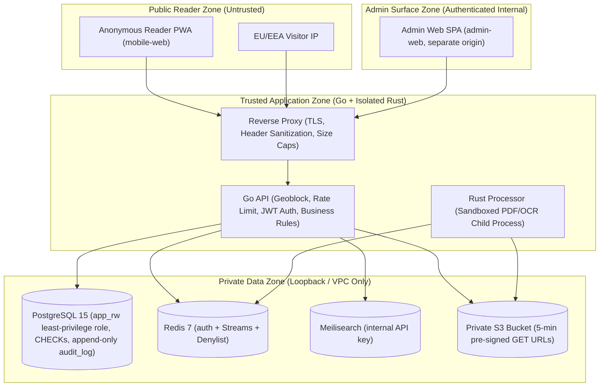

# Security Architecture & STRIDE Threat Model

- **Document Path:** `docs/10-security/SECURITY_ARCHITECTURE.md`
- **Phase:** Phase 06 — Architecture (Charter PART 05)
- **Traceability:** `SYSTEM_CONTEXT.md`, `LOW_LEVEL_DESIGN.md`, `DATABASE_DESIGN.md`, `openapi.yaml`, `PERMISSION_MATRIX.md`, `ADR-005`, `ADR-007`, `ADR-008`, `ADR-015`
- **Status:** Draft for PO Audit

---

## 1. Trust Boundaries

### Three Primary Trust Boundaries
1. **Admin vs. Public Reader Boundary:**
   - Separate static builds and origins (`admin.<domain>` vs. `<domain>`).
   - Separate route namespaces (`/api/v1/admin/*` requires valid non-revoked Admin JWT; public `/api/v1/*` has zero write access to cases/evidence and unconditionally filters `status = 'PUBLISHED'`).
   - *Failure mode:* If JWT middleware or Redis denylist fails, `/api/v1/admin/*` **fails closed (`HTTP 401`/`503`)**.
2. **Sandbox vs. Production Boundary (`ADR-003`, `ADR-005`):**
   - Local sandbox permits PostgreSQL `--auth=trust` strictly on `127.0.0.1:5432` enforced by `Makefile` host/port guards.
   - Staging and production **MUST** enforce `scram-sha-256`, TLS in transit, Redis `requirepass`, Meilisearch master/search API keys, non-root service users, and `APP_ENV` startup assertions that abort boot if `trust` auth or placeholder secrets are detected.
3. **Database vs. Application Boundary:**
   - The Go API connects using a least-privilege PostgreSQL role (`app_rw`) that has `SELECT/INSERT/UPDATE` on operational tables, **ONLY `INSERT/SELECT` on `audit_log`**, and **NO `DDL`/`SUPERUSER` privileges**.
   - Critical legal invariants (Q5 third-party exhibit `CHECK`, 4×3 matrix blocks, legal-review publication trigger, append-only `audit_log` trigger) live **inside PostgreSQL** so even a compromised or buggy application layer cannot silently violate them.

---

## 2. STRIDE Threat Model (`T1` – `T8`)

| ID | Threat | STRIDE Category | Attack Vector & Impact | Explicit Controls | Failure Mode / Fallback |
|---|---|---|---|---|---|
| **T1** | **Attacker enumerates draft cases via API** | Information Disclosure | Attacker guesses slugs (`GET /api/v1/cases/ftx-draft`) or probes `GET /api/v1/cases?status=DRAFT` or `GET /api/v1/evidence/{uuid}` to leak unreviewed, potentially defamatory drafts. | 1. Public SQL queries unconditionally include `WHERE status = 'PUBLISHED'`. 2. Draft, `IN_REVIEW`, `APPROVED`, `RETRACTED`, and nonexistent slugs return the **exact same `HTTP 404` payload** (`NOT_FOUND`) with zero status-hinting error text. 3. `GET /api/v1/cases?status=<non-PUBLISHED>` rejected with `HTTP 400`. 4. Meilisearch indexes **only** `PUBLISHED` cases (never drafts). 5. Mandatory negative integration tests (`REQ-016`). | If an indexing bug ever leaves a retracted case in Meilisearch, Go verifies live Postgres visibility on `GET /cases/{slug}` and `GET /evidence/{id}`, returning `404` while background sync retries Meilisearch deletion every 5s. |
| **T2** | **Admin token theft → full case manipulation** | Spoofing / Elevation of Privilege | Stolen Admin Bearer JWT (via XSS, leaked log, or compromised browser) used to alter published dossiers, bypass legal review, or delete evidence. | 1. Short-lived **60-minute JWT TTL** (no long-lived refresh/static tokens). 2. Strict CSP (`script-src 'self'`, no inline scripts) + `X-Frame-Options: DENY` on `admin-web` to block XSS. 3. Per-token `jti` checked against Redis revocation denylist on every admin request; logout & emergency key rotation revoke immediately. 4. Even with a valid Admin JWT, **database triggers still block publishing without a `legal_review_records` row** and **block `audit_log` modification** (T7). 5. Optional reverse-proxy IP allowlist on `admin.<domain>`. | If Redis denylist is unreachable, admin JWT middleware **fails closed (`HTTP 503`)** rather than accepting potentially revoked tokens. |
| **T3** | **File upload path traversal / zip-bomb / PDF-with-malicious-JS** | Tampering / Denial of Service / Elevation | Malicious filename (`../../etc/passwd`), compressed decompression bomb exhausting VPS RAM/disk, or PDF containing embedded JavaScript executing in a reader's browser. | 1. **Ignore client filenames:** S3 `object_key` generated strictly from server UUID + SHA-256 + validated extension (`cases/{case_id}/evidence/{evidence_id}/{sha256}.{ext}`). 2. **Size & magic-byte gates:** Hard `25 MB` upload cap at reverse proxy + Go; Rust verifies file magic bytes (`%PDF-`, PNG, JPEG) and rejects mismatched MIME types. 3. **Process isolation & bomb guards:** PDF/OCR parsing runs only in `processor-rust` (never in Go) with `30s` parse / `90s` OCR timeouts, `500`-page max, `>100:1` decompression-ratio abort, and `RLIMIT_AS` memory cap on OCR subprocess. 4. **Safe browser delivery:** S3 pre-signed URLs set `Content-Disposition: inline` / `attachment` with strict `Content-Type`, served from the S3 origin (not the PWA origin) with `Content-Security-Policy: sandbox` / PDF.js sandboxed rendering with JS execution disabled. | Hostile file crashes only the isolated Rust child task; job moves to `evidence:dlq` as `PROCESSING_FAILED` and is blocked from case publication. |
| **T4** | **Correction-request spam or abuse** | Denial of Service / Repudiation | Bots flood `POST /api/v1/corrections` (anonymous endpoint) to exhaust PostgreSQL storage or bury genuine legal takedown notices in noise. | 1. Strict IP rate limit (`3 req/hour per IP`, Redis fixed window, `HTTP 429` + `Retry-After`). 2. Mandatory `Idempotency-Key` header prevents duplicate retries. 3. Hidden `honeypot_field` / `website` honeypot fields in `CorrectionCreateRequest`; populated submissions silently return `HTTP 202` and are dropped without writing to Postgres. 4. Strict payload bounds (`description <= 5000 chars`, `supporting_citation <= 1000 chars`, max body `16 KB`). 5. Admin triage supports `SPAM_DISMISSED` filtering without deleting genuine notices. | If Redis rate limiter is unavailable, `POST /api/v1/corrections` **fails closed (`HTTP 503`)** so bots cannot bypass rate limits during an outage. |
| **T5** | **Query-string injection to Meilisearch** | Tampering / Information Disclosure | Attacker crafts `q` or facet parameters (`q=fraud" OR status="DRAFT`) attempting to break out of Meilisearch filter expressions and access unpublished records. | 1. `q` is passed exclusively via the `meilisearch-go` SDK structured JSON `q` parameter (SDK-escaped; never concatenated into `filter`). 2. Filter attributes (`category`) are validated against strict Go enum allowlists before constructing typed Meilisearch filter arrays (`["status = \"PUBLISHED\"", "category = \"financial_crime\""]` per ADR-019). 3. Defense-in-depth: unpublished/draft cases are **never indexed in Meilisearch** in the first place, and `Retract` / re-review demotion delete the case synchronously. 4. Query length capped at `200 chars`; Meilisearch API key held server-side in Go (never exposed to browser). | Invalid query length or enum parameter returns `HTTP 400` before Meilisearch is contacted; Meilisearch timeout (`2s`) returns `HTTP 503`. |
| **T6** | **Evidence metadata tampering via `PUT` after publish** | Tampering / Repudiation | Admin (or compromised token) silently alters `verification_tier`, `license_status`, `source_type`, or `source_citation` on a live published case via `PUT /api/v1/admin/evidence/{id}` without legal re-review. | 1. Go handler runs inside a PostgreSQL transaction: if parent `cases.status = 'PUBLISHED'` and any integrity field changes, it **atomically transitions `cases.status` to `'IN_REVIEW'`**, clears `published_legal_review_id`, removes the case from Meilisearch, and appends `EVIDENCE_UPDATED_REREVIEW` to `audit_log`. 2. Re-publishing requires a new `legal_review_records` entry (`REQ-027`). 3. Q5 `CHECK` constraint and 4×3 matrix checks run on every `UPDATE` just as on `INSERT`. | If Meilisearch removal fails transiently during transition to `IN_REVIEW`, `search_sync_pending = TRUE` triggers 5s retry loop while live `GET /cases/{slug}` immediately returns `404`. |
| **T7** | **Audit log deletion or tampering** | Repudiation | Attacker or accidental script runs `DELETE FROM audit_log` or `UPDATE audit_log` to erase chain-of-custody evidence or cover unauthorized changes. | 1. Least-privilege DB role (`app_rw`) has **ONLY `INSERT, SELECT`** on `audit_log` (`REVOKE UPDATE, DELETE, TRUNCATE`). 2. PostgreSQL `BEFORE UPDATE OR DELETE` trigger unconditionally raises an exception (`audit_log is append-only`). 3. Daily encrypted `pg_dump` exported off-box to an immutable/versioned backup bucket. | Any attempted `UPDATE`/`DELETE` fails immediately at PostgreSQL with an exception and is logged in Postgres server logs. |
| **T8** | **Geoblock bypass via proxy/VPN or header spoofing** | Compliance Bypass (`ADR-008`) | (a) Attacker sends spoofed `X-Forwarded-For: 8.8.8.8` or `CF-IPCountry: US` directly to bypass EU/EEA/UK block; (b) EU resident uses a commercial VPN exit node in the US. | 1. **Cloudflare-edge-enforced geoblock + origin allowlist:** In production, Cloudflare sets `CF-IPCountry` at the edge and the origin firewall restricts ingress exclusively to published Cloudflare IP ranges (preventing direct internet hits that spoof `CF-IPCountry`). 2. **Application-layer defense-in-depth:** Go `Geoblock` middleware runs **before** rate-limiting on all public reader routes (`/api/v1/cases*`, `/api/v1/evidence*`, `/api/v1/search`, `/api/v1/corrections`), blocking all 27 EU + 3 EEA + UK (`GB`/`UK`) codes with static `HTTP 451` HTML (`"Not available in your region"`) and zero application content. Admin routes (`/api/v1/admin/*`) and `/health` bypass geoblocking. Absent `CF-IPCountry` is allowed strictly in local development. 3. **Known limitation documented (`ADR-008`):** Commercial VPN bypass cannot be eliminated with 100% certainty via IP geoblocking; paired with zero EU-origin cases (`REQ-028`), zero consumer accounts (`ADR-007`), and explicit Terms of Service non-targeting notice. | Origin network policy rejects any non-Cloudflare source IP before traffic reaches the Go API; if Cloudflare edge rules ever pass an EU/EEA/UK country code, Go middleware still enforces `HTTP 451`. |

---

## 3. Explicitly Out of Scope at MVP (With Rationale)

| Control | Status at MVP | Rationale & Re-Evaluation Trigger |
|---|---|---|
| **Multi-tenant isolation** | Out of scope | Single publisher (solo founder) operating one curated catalog; multi-tenancy adds schema/auth complexity with zero product value. |
| **Enterprise SSO / OIDC / SAML** | Out of scope | Only 1 internal `ADMIN` account at MVP; Argon2id + short-lived JWT + optional proxy IP allowlist is proportionate and zero-cost. |
| **MFA (TOTP/WebAuthn) on Admin** | Deferred to post-MVP / v1.0 hardening | Single founder can restrict `admin.<domain>` via VPN/IP allowlist at proxy layer in MVP; add TOTP MFA before inviting any external `RESEARCHER` user. |
| **Per-case granular RBAC / ACLs** | Out of scope | `ADMIN` owns all cases at MVP; coarse role-level RBAC (`ADMIN`, `RESEARCHER` in `PERMISSION_MATRIX.md`) suffices until a multi-researcher team exists. |
| **WAF / DDoS Enterprise Tier** | Out of scope (`$0` paid APIs) | Standard reverse-proxy connection/body limits + Redis rate limiting + optional free-tier Cloudflare DNS/proxy fit the `$300–$500` budget. |

---

## 4. Admin Authentication, JWT Rotation & Session Policies

1. **JWT Secret Rotation Policy:**
   - Signing keys are loaded from `ADMIN_JWT_SIGNING_KEYS` (JSON map of `{ "kid": "base64-256bit-secret" }`) plus `ADMIN_JWT_ACTIVE_KID`.
   - Every issued JWT includes a `kid` header and unique `jti` (UUIDv7).
   - **Planned Rotation (every 90 days):** Add new `kid_N+1` to `ADMIN_JWT_SIGNING_KEYS`, switch `ADMIN_JWT_ACTIVE_KID` to `kid_N+1`, wait `> 60 minutes` (1 full TTL) so valid `kid_N` tokens naturally expire, then remove `kid_N`.
   - **Emergency Rotation (suspected compromise):** Immediately replace `ADMIN_JWT_SIGNING_KEYS` with a single fresh `kid` and restart `backend-go` — instantaneously invalidating 100% of outstanding admin tokens.
2. **Admin Login Rate Limiting (`POST /api/v1/admin/login`):**
   - Hard limit: **5 attempts per 15 minutes per IP** (tracked in Redis).
   - Account-level progressive lockout: after **5 consecutive failed logins** on an admin email, lock login for `15 minutes` (doubling up to `60 minutes`) and record `ADMIN_LOGIN_FAILED` in `audit_log` (without logging attempted password or client IP).
   - Constant-time Argon2id verification + uniform `HTTP 401` (`INVALID_CREDENTIALS`) whether email or password is wrong to prevent admin email enumeration.
3. **Admin Session TTL:**
   - Access JWT TTL: **60 minutes (`exp = iat + 3600`)**.
   - **No persistent refresh tokens** in MVP — after 60 minutes of authoring, the solo founder re-authenticates (bounding stolen-token blast radius to <= 1 hour).
   - Explicit logout adds `jti` to Redis denylist (`SET jwt:revoked:{jti} 1 EX <remaining_ttl>`).
